<!-- Conversão automática do PDF "TCC_Marcelo 1.pdf" (74 páginas) para Markdown. O texto foi extraído do PDF, não reescrito. Figuras, diagramas, capturas de tela e anexos manuscritos estão na pasta imagens/. -->

**UNIVERSIDADE ZAMBEZE FACULDADE DE CIÊNCIAS E TECNOLOGIA** 

Licenciatura em Engenharia Informática 

**PROPOSTA DE DESENVOLVIMENTO DE UM SISTEMA DE INFORMAÇÃO E APOIO À TOMADA DE DECISÃO PARA AGRICULTORES DO SDAE NO DISTRITO DE NHAMATANDA** 

Marcelo Tesai Faife 

Beira,2026 

**UNIVERSIDADE ZAMBEZE FACULDADE DE CIÊNCIAS E TECNOLOGIA** 

Licenciatura em Engenharia Informática 

**PROPOSTA DE DESENVOLVIMENTO DE UM SISTEMA DE INFORMAÇÃO E APOIO À TOMADA DE DECISÃO PARA AGRICULTORES DO SDAE NO DISTRITO DE NHAMATANDA** 

Monografia apresentada ao Departamento de Engenharia Informática da Faculdade de Ciências e Tecnologia da Universidade Zambeze, como requisito parcial para a obtenção do grau de Licenciatura em Engenharia Informática. 

Marcelo Tesai Faife 

**Orientador:** 

**Cristian Franklin Coulon** 

Beira, 2026 

## **DECLARAÇÃO DE HONRA** 

Eu,  Marcelo Tesai Faife, declaro que esta Monografia nunca foi apresentada para a obtenção de qualquer grau académico ou num outro âmbito e que a mesma constitui o resultado do meu trabalho. Ela é resultado do meu esforço e empenho, sob orientação do meu supervisor, o seu conteúdo é original e as fontes consultadas estão devidamente mencionadas no texto e nas referências bibliográficas. Esta monografia é apresentada em cumprimento parcial dos requisitos para a obtenção do grau de Licenciatura em Engenharia Informática, da Universidade Zambeze. 

Beira, aos ___ de ______________ de 2026. 

_____________________________________________ 

( Marcelo Tesai Faife) 

## **AGRADECIMENTOS** 

A realização deste Trabalho de Conclusão de Curso representa muito mais do que o encerramento de uma etapa acadêmica: reflete a concretização de uma jornada marcada por desafios, aprendizados, renúncias, perdas e esperança. Acima de tudo, retrata o apoio fundamental de pessoas extraordinárias que estiveram ao meu lado em cada passo. 

Em primeiro lugar, agradeço a Deus pela vida, pela força, pela sabedoria e pela coragem concedidas para superar os momentos mais difíceis e permitir a minha chegada a este momento. 

À minha mãe, expresso a minha mais profunda gratidão. Foi meu porto seguro durante toda esta trajetória. Obrigado por acreditar no meu potencial, pela presença constante, pelos conselhos, pelas orações, pelos infinitos sacrifícios e por jamais me deixar desistir. Esta conquista também é sua. 

Aos meus irmãos, Elias, Anselmo e Edmilson, agradeço pelo companheirismo, afeto e apoio incondicional. Cada um, à sua maneira, foi essencial para que eu seguisse em frente. 

Presto uma homenagem carregada de saudade e gratidão ao meu avô, que partiu durante a minha formação. Sua presença, incentivo e ajuda no início do curso foram fundamentais. Embora sua ausência deixa um vazio permanente, seus ensinamentos e a sua confiança em mim permanecem vivos. Espero honrar a sua memória com este trabalho, que também carrega o fruto do seu esforço. 

À minha querida tia Glória, que também nos deixou quando eu cursava o quarto ano, dedico minha eterna gratidão. Perdê-la em uma fase tão decisiva foi um golpe doloroso, mas a sua lembrança transformou-se em força para eu perseverar e concluir este objetivo. Sua memória continuará viva em meu coração. 

Aos meus amigos André, Vanessa, Peter, Fernando Zambo, Clayton Chilaule, Amâncio Mbahane, Geraldo Nuvunga, Murade Lobo, René Descartes e Delfina dos Prazeres, agradeço do fundo do coração pela amizade genuína, pelos conselhos e pelas risadas partilhadas. Nos momentos felizes e, sobretudo, nos dias mais árduos, a presença de vocês fez toda a diferença. 

Aos meus primos, agradeço pelo carinho e incentivo constante, com uma gratidão especial à Romana Goba, pelo apoio dedicado ao longo dessa caminhada. Estendo meus agradecimentos aos meus tios Davio Faife, Fidel João, Paulo Faife, Paulo Maxaxe, Alcides e João de Oliveira, pelas palavras de encorajamento, pela preocupação e pela força transmitida. 

À minha avó Claudina, manifesto meu carinho e agradecimento por tudo o que fez por mim ao longo desta jornada. Agradeço também às Irmãs Missionárias Capuchinhas, em especial à Irmã Davina, por acreditar no meu potencial e por me apoiar constantemente com orações e incentivo. 

Agradeço, finalmente, a todos que, direta ou indiretamente, contribuíram para a realização deste trabalho e para a minha formação. Cada gesto de solidariedade, palavra de incentivo e ajuda recebida foram valiosos para a construção deste resultado. 

Esta conquista não é individual — pertence a todos que acreditaram em mim, caminharam ao meu lado e me sustentaram quando as dificuldades exigiram mais do que as minhas próprias forças. 

A todos vocês, o meu mais sincero e profundo agradecimento. 

## **PARECER FINAL DO ORIENTADOR** 

Eu, Cristian Franklin Coulon, orientador do Departamento de Engenharia Informática da Faculdade de Ciências e Tecnologia, da Universidade Zambeze, declaro, na qualidade de orientador da monografia de licenciatura submetida por  Marcelo Tesai Faife, com o tema “Proposta de Sistema de desenvolvimento de um sistema de informação e apoio a tomada de decisão para agricultores do SDAE no distrito  de Nhamatanda ”, declarar que os trabalhos previstos no âmbito de sua monografia de licenciatura em Engenharia Informática foram concluídos com sucesso. Assim, o trabalho apresentado pelo candidato reúne a qualidade científica e as condições necessárias para que o estudante seja submetido à prova de defesa de licenciatura. 

Beira, aos 07 de Agosto de 2026 

_____________________________________ MSc. Cristian Franklin Coulon 

## **DEDICATÓRIA** 

Dedico esta monografia a Deus, por ser minha luz, guia e fortaleza em cada passo desta caminhada; à minha família, pelo amor incondicional, apoio constante e por ser a base de todas as minhas conquistas; e aos meus amigos e colegas, pelo incentivo, pelas horas compartilhadas e por tornarem esta jornada acadêmica mais leve, rica e inesquecível. 

## **Índice** 

|Lista de Figuras … 10|
|---|
|Lista de Tabelas … 11|
|Lista de Acrónimos e abreviatura … 12|
|Resumo … 13|
|Abstract … 14|
|CAPÍTULO I: INTRODUÇÃO … 1|
|1.1. Contextualização do Problema … 2|
|1.2. Objectivos … 2|
|1.2.1. Objectivo Geral … 2|
|1.2.2. Objectivos Específicos … 2|
|1.3. Justificativa … 3|
|1.4. Problematização … 4|
|1.5. Hipóteses … 4|
|1.6. Delimitação do Estudo … 5|
|1.6.1. Delimitação Espacial … 5|
|1.6.2. Delimitação Temporal … 5|
|1.6.3. Delimitação do Objecto … 5|
|1.7. Estrutura da Monografia … 5|
|CAPÍTULO II: REVISÃO DA LITERATURA … 7|
|2.1. Conceitos Fundamentais … 7|
|2.2. Sistemas de Apoio à Decisão na Agricultura … 8|
|2.3. Tecnologias de Informação e Comunicação na Agricultura … 10|
|2.3.1. Plataformas Digitais Agrícolas … 11|
|2.3.2. APIs Meteorológicas e Dados Climáticos … 12|
|2.4. Agricultura Sustentável e Gestão de Recursos … 13|
|2.5. Trabalhos Relacionados … 14 |
|CAPÍTULO III: METODOLOGIA … 15|
|3.1. Tipo de Pesquisa … 15|
|3.2. Método de Desenvolvimento do Sistema … 15|
|3.3. População e Amostra … 16|
|3.3.1. População … 16|
|3.3.2. Amostra dos Agricultores … 16|
|3.3.3. Amostra dos Técnicos do SDAE … 17|
|3.4. Técnicas de Recolha de Dados … 18|
|3.4.1. Questionário … 18|
|3.4.2. Entrevista Semiestruturada … 19|
|3.5. Instrumento de Recolha de Dados … 19|
|3.6. Técnicas de Análise de Dados … 20|
|3.6.1. Análise Quantitativa … 20|

|3.6.2. Análise Qualitativa … 20|
|---|
|3.7. Tecnologias e Ferramentas Utilizadas … 20|
|3.7.1. Tecnologias de Desenvolvimento … 20|
|3.7.2. Ferramentas … 21 |
|CAPÍTULO IV: APRESENTAÇÃO E DISCUSSÃO DE RESULTADOS … 22|
|4.1.Interpretação dos dados coletados … 22|
|4.2. Modelagem do sistema … 26|
|4.2.1. Requisitos … 26|
|Requisitos funcionais … 26|
|Requisitos não funcionais … 28|
|4.3. Diagramas … 28|
|4.3.1. Diagrama entidade relacionamento … 28|
|4.3.2.Diagrama de sequência … 30|
|4.3.3.Diagrama de classes … 32|
|4.3.4.Diagrama de Caso de Uso … 34|
|4.3.6.Diagrama de atividade … 34|
|4.4.Arquitectura do Sistema … 35|
|4.4.1. Arquitectura de Software … 36|
|4.4.2. Demonstração das funcionalidades do sistema … 37 |
|CAPÍTULO V: CONCLUSÕES E SUGESTÕES … 43|
|5.1. Conclusão … 43|
|5.2. Sugestões … 44|
|CAPÍTULO VI: REFERÊNCIA BIBLIOGRÁFICA … 45 |
|APÊNDICE I: Questionário sobre o Acesso à Informação Agrícola e o Uso de Tecnologias|
|Digitais pelos Agricultores do Distrito de Nhamatanda … 48|
|APÊNDICE II: Questionário online aplicado aos agricultores do distrito de Nhamatanda … 52|
|ANEXO I: Credencial de autorização para recolha de dados nos Serviços Distritais de Actividades Económicas  (SDAE) … 56|
|ANEXO II: Questionário aplicado ao Serviço Distrital de Actividades Económicas(SDAE) … 57|

## **Lista de Figuras** 

|Figura 01: Componentes principais de um Sistema de Apoio à Decisão na Agricultura … 9|
|---|
|Figura 02: Impacto das Tecnologias de Informação e Comunicação na agricultura de|
|pequena escala … 11|
|Figura 03: Arquitectura de um sistema IoT de monitorização agrícola … 12|
|Figura 04: Resultado Questão 6 … 23|
|Figura 05: Resultado Questão 8 … 23|
|Figura 06: Resultado Questão 10 … 24|
|Figura 07: Resultado Questão 12 … 24|
|Figura 08: Resultado Questão 14 … 25|
|Figura 09: Resultado Questão 15 … 26|
|Figura 04.Diagrama Entidade Relacionamento … 29|
|Figura 05.Diagrama de sequência:login … 30|
|Figura 06.Diagrama de sequência: emissão do técnico … 31|
|Figura 07.Diagrama de sequência: registo do solo … 32|
|Figura 08.Diagrama de classes … 33|
|Figura 09.Diagrama de caso de uso … 34|
|Figura 10.Diagrama de atividade … 35|
|Figura 11: Página inicial do sistema (landing page) … 37|
|Figura 12: Tela de registo do agricultor … 38|
|Figura 13: Tela de autenticação (login) do sistema … 39|
|Figura 14: Painel da Exploração do Agricultor … 40|
|Figura 15: Dashboard do Técnico SDAE … 41|
|Figura 16: Dashboard do Administrador … 42|

|**Lista de Tabelas**|
|---|
|Tabela 01: Resumo da população e amostra do estudo … 18|
|Tabela 02: Requisitos Funcionais … 27|
|Tabela 03: Requisitos não funcionais … 28|

## **Lista de Acrónimos e abreviatura** 

|API|Application Programming Interface (Interface de Programação de Aplicações).|
|---|---|
|CSAW|Climate Smart Agriculture and Water.|
|FAO|Food and Agriculture Organization (Organização das Nações Unidas para a Alimentação e Agricultura).|
|GSMA|Global System for Mobile Communications Association.|
|INAM|Instituto Nacional de Meteorologia de Moçambique.|
|IoT|Internet of Things (Internet das Coisas).|
|JWT|JSON Web Token.|
|MVP|Minimum Viable Product (Produto Mínimo Viável)|
|SAD|Sistema(s) de Apoio à Decisão.|
|SDAE|Serviços Distritais de Actividades Económicas.|
|UML|Unified Modeling Language (Linguagem de Modelagem Unificada).|

## **Resumo** 

O presente trabalho propõe o desenvolvimento de um sistema de informação e apoio à tomada de decisão, denominado KulimaTech, destinado aos agricultores e técnicos do SDAE no distrito de Nhamatanda, Moçambique. O sistema visa colmatar três problemas identificados no distrito: o acesso limitado a informação meteorológica, a ausência de monitorização sistemática da humidade do solo e a comunicação deficiente entre agricultores e técnicos de extensão agrícola. Para o efeito, foi realizado um levantamento de dados junto de 100 agricultores e da totalidade dos técnicos do SDAE de Nhamatanda, através de questionário e entrevista semiestruturada, cujos resultados fundamentaram os requisitos do sistema. Com base na metodologia ágil Scrum, foi desenvolvido um protótipo funcional (MVP), estruturado numa arquitectura cliente-servidor em três camadas (Next.js, Supabase e PostgreSQL), que integra o registo e validação de leituras de humidade do solo, a emissão de recomendações de culturas, o reporte e acompanhamento de ocorrências de pragas, e um canal de comunicação directo entre agricultor e técnico. O sistema foi validado junto de um grupo restrito de utilizadores piloto, tendo os resultados demonstrado a viabilidade técnica da solução e uma elevada receptividade por parte dos agricultores. Refira-se, contudo, que o trabalho não contemplou a implementação em larga escala do sistema, nem a finalização da funcionalidade de notificações em tempo real, aspectos que permanecem como sugestões para investigações futuras. 

**Palavras-chave:** Apoio à Tomada de Decisão, Tecnologias de Informação na Agricultura, Agricultura Sustentável. 

## **Abstract** 

This work proposes the development of an information and decision-support system, named KulimaTech, aimed at farmers and technicians of the SDAE in the Nhamatanda district, Mozambique. The system seeks to address three problems identified in the district: limited access to weather information, the absence of systematic soil moisture monitoring, and poor communication between farmers and agricultural extension technicians. To this end, data was collected from 100 farmers and all SDAE technicians in Nhamatanda through questionnaires and semi-structured interviews, whose results informed the system's requirements. Based on the Scrum agile methodology, a functional prototype (MVP) was developed, structured on a three-tier client-server architecture (Next.js, Supabase, and PostgreSQL), integrating the registration and validation of soil moisture readings, the issuance of crop recommendations, the reporting and tracking of pest occurrences, and a direct communication channel between farmer and technician. The system was validated with a limited group of pilot users, and the results demonstrated the technical feasibility of the solution and a high level of receptiveness among farmers. It should be noted, however, that this work did not include a large-scale implementation of the system, nor the completion of real-time notification functionality, aspects that remain as suggestions for future research. 

**Keywords:** Decision Support, Information Technology in Agriculture, Sustainable Agriculture. 

## **CAPÍTULO I: INTRODUÇÃO** 

A agricultura constitui um dos pilares fundamentais da economia moçambicana, sendo a principal fonte de subsistência de cerca de 70% da população rural do país (FAO, 2022). No distrito de Nhamatanda, província de Sofala, esta realidade assume particular relevância, uma vez que a maioria das famílias depende directamente da actividade agrícola para garantir a segurança alimentar e gerar rendimento. Apesar da sua importância estratégica, o sector enfrenta constrangimentos estruturais que limitam a produtividade e a competitividade das explorações familiares. 

Entre os principais desafios identificados destacam-se a ausência de sistemas de monitorização meteorológica acessíveis às comunidades rurais, a escassez de informação técnica sobre a gestão do solo e o controlo de pragas, e a comunicação deficiente entre os agricultores e os técnicos do Serviço Distrital de Actividades Económicas (SDAE). Esta conjuntura leva a que as decisões agrícolas sejam tomadas sobretudo com base em experiência empírica e tradição, tornando a produção altamente vulnerável às variações climáticas e a eventos imprevistos. 

Os Sistemas de Apoio à Decisão (SAD) surgem, neste contexto, como instrumentos tecnológicos com elevado potencial para transformar a gestão agrícola. Turban et al. (2007) definem-nos como sistemas computacionais interactivos que auxiliam os decisores na resolução de problemas semi-estruturados e não estruturados, integrando dados de múltiplas fontes e disponibilizando informação processada de forma acessível e oportuna. A sua aplicação à agricultura, designada agricultura de precisão, tem produzido resultados significativos em contextos semelhantes ao de Nhamatanda, contribuindo para o aumento da produtividade e para a redução de perdas (Godwin et al., 2003). 

É neste enquadramento que se insere o presente projecto, que propõe o desenvolvimento de um sistema de informação e apoio à tomada de decisão para os agricultores do SDAE no distrito de Nhamatanda. O sistema integrará dados meteorológicos provenientes de fontes externas, informação sobre a humidade do solo recolhida pelos agricultores e validada pelos técnicos, recomendações de culturas adequadas a cada época do ano e orientações para o combate a pragas, complementadas por um canal de comunicação directo entre agricultores e técnicos do SDAE, colmatando uma lacuna de longa data na disseminação do conhecimento agrícola na região. 

## **1.1. Contextualização do Problema** 

O distrito de Nhamatanda situa-se na zona centro de Moçambique, na província de Sofala, e possui uma economia predominantemente agrícola, assente sobretudo na agricultura de subsistência. As culturas mais praticadas incluem o milho, o feijão, a mandioca e o amendoim. A região apresenta um clima tropical húmido, com uma estação chuvosa bem definida (Outubro a Março) e uma estação seca (Abril a Setembro), o que torna o planeamento agrícola fortemente dependente das condições meteorológicas. 

As alterações climáticas têm vindo a modificar progressivamente os padrões de precipitação e temperatura na região, tornando as estações menos previsíveis e aumentando a frequência de fenómenos extremos, como secas e cheias. Segundo dados do Instituto Nacional de Meteorologia de Moçambique (INAM, 2021), a variabilidade climática na bacia do rio Pungué, que abrange o distrito de Nhamatanda, tem aumentado nas últimas duas décadas, com impacto directo na produtividade agrícola. 

A esta realidade climática somam-se dificuldades adicionais: o acesso limitado a informação técnica actualizada, a inexistência de sistemas de alerta precoce para pragas e a distância geográfica em relação às sedes dos serviços de extensão agrícola do SDAE. Estas barreiras traduzem-se numa tomada de decisão deficiente, em perdas evitáveis de produção e numa reduzida capacidade de adaptação às condições climáticas adversas. 

## **1.2. Objectivos** 

## **_1.2.1. Objectivo Geral_** 

Desenvolver um sistema de informação e apoio à tomada de decisão para os agricultores do SDAE no distrito de Nhamatanda, que integre dados meteorológicos, informação sobre a humidade do solo, recomendações de culturas e estratégias de combate a pragas, facilitando a comunicação entre técnicos e agricultores e promovendo uma agricultura mais produtiva e sustentável. 

## **_1.2.2. Objectivos Específicos_** 

Levantar as necessidades informacionais dos agricultores e dos técnicos do SDAE no distrito de Nhamatanda. 

Integrar dados meteorológicos externos e informação sobre a humidade do solo no sistema, apoiando o planeamento das épocas de sementeira e de colheita. 

Desenvolver módulos de recomendação de culturas e de orientação para o combate a pragas, adequados às condições climáticas da região. 

Implementar um canal de comunicação digital entre agricultores e técnicos do SDAE e validar o sistema junto de um grupo piloto de utilizadores. 

## **1.3. Justificativa** 

A pertinência do presente projecto assenta em três dimensões: económica, social e tecnológica. 

Do ponto de vista económico, a agricultura constitui a principal fonte de rendimento da maioria das famílias do distrito de Nhamatanda. As perdas resultantes de decisões inadequadas, como a escolha incorrecta do período de sementeira ou a falha no combate precoce a pragas, afectam directamente a segurança alimentar e o rendimento das famílias rurais. Estima-se que as perdas pós-colheita no sector agrícola moçambicano rondem os 30%, parte das quais poderiam ser evitadas com acesso a informação técnica adequada (Ministério da Agricultura e Segurança Alimentar, 2019). 

Do ponto de vista social, a comunicação deficiente entre agricultores e técnicos do SDAE constitui uma barreira estrutural ao desenvolvimento agrícola da região. A implementação de uma plataforma de comunicação digital aproximará estes dois grupos de actores, democratizando o acesso ao conhecimento técnico e fortalecendo as redes de apoio às comunidades rurais. 

Do ponto de vista tecnológico, o crescente acesso a dispositivos móveis e à internet nas zonas rurais de Moçambique, impulsionado pela expansão das redes de telecomunicações, cria condições favoráveis à adopção de soluções digitais no sector agrícola. Segundo a GSMA (2023), a penetração do telemóvel nas zonas rurais de Moçambique ultrapassa os 45%, representando uma oportunidade real para a implementação de sistemas de informação agrícola de base móvel. 

A inexistência de sistemas semelhantes concebidos especificamente para o contexto do distrito de Nhamatanda reforça a originalidade e a pertinência do presente projecto, que não pretende substituir os serviços de extensão agrícola existentes, mas complementá-los, ampliando o seu alcance e a sua eficácia. 

## **1.4. Problematização** 

A tomada de decisão agrícola no distrito de Nhamatanda é condicionada por um conjunto de factores inter-relacionados que comprometem a produtividade e a sustentabilidade do sector, dos quais se destacam três problemas centrais. 

O primeiro prende-se com a falta de acesso a informação meteorológica confiável e atempada: as estações meteorológicas automáticas são escassas na região e os agricultores não dispõem de previsões climáticas adaptadas à escala local, o que impede um planeamento eficaz das épocas de sementeira e colheita e expõe as culturas a riscos evitáveis. 

O segundo problema é a ausência de monitorização sistemática da humidade do solo, parâmetro determinante para definir o momento ideal de sementeira e que varia em função da precipitação, da topografia e das características pedológicas de cada parcela. Sem dados objectivos sobre este parâmetro, os agricultores recorrem a métodos empíricos, frequentemente imprecisos. 

O terceiro problema é a comunicação ineficiente entre agricultores e técnicos do SDAE. Estes últimos possuem conhecimento técnico valioso sobre práticas agrícolas, pragas emergentes e estratégias de adaptação climática, mas a transmissão desse conhecimento aos agricultores é limitada pelas barreiras geográficas, pela falta de meios de comunicação adequados e pela ausência de um sistema centralizado de partilha de informação. 

Face a estes problemas, coloca-se a seguinte questão de investigação: 

_Como pode um sistema de informação e apoio à tomada de decisão melhorar o acesso dos agricultores do distrito de Nhamatanda a informação meteorológica, a dados sobre a humidade do solo, a recomendações de culturas e a orientações de combate a pragas, facilitando simultaneamente a comunicação com os técnicos do SDAE?_ 

## **1.5. Hipóteses** 

H1: A implementação de um sistema híbrido de informação e apoio à tomada de decisão para os agricultores de Nhamatanda melhora significativamente a produtividade agrícola, ao disponibilizar dados meteorológicos precisos, informação sobre a humidade do solo e recomendações sobre as culturas mais adequadas a cada época de plantio, reduzindo as perdas associadas a decisões baseadas em métodos empíricos. 

H2: A criação de um canal de comunicação digital entre técnicos e agricultores, integrado na plataforma, permite a disseminação rápida e eficaz de informação sobre práticas agrícolas, combate a pragas e alterações climáticas, contribuindo para decisões mais informadas e para o fortalecimento das redes de apoio às comunidades rurais do distrito de Nhamatanda. 

H3: A adopção de uma interface adaptada às condições de conectividade e ao nível de literacia digital dos utilizadores rurais aumenta a taxa de adopção do sistema pelos agricultores do distrito, tornando-o uma ferramenta de uso regular no planeamento das actividades agrícolas. 

## **1.6. Delimitação do Estudo** 

## **_1.6.1. Delimitação Espacial_** 

O estudo foi realizado no distrito de Nhamatanda, província de Sofala, onde se verificam os desafios relacionados com o acesso à informação meteorológica, a gestão do solo e a comunicação entre agricultores e técnicos do SDAE. 

## **_1.6.2. Delimitação Temporal_** 

A pesquisa decorreu entre Dezembro de 2025 e Junho de 2026, período que abrangeu a recolha de dados, o desenvolvimento e a validação da solução proposta. 

## **_1.6.3. Delimitação do Objecto_** 

O objecto deste estudo é o desenvolvimento de um sistema de informação e apoio à tomada de decisão para agricultores do SDAE, centrado na integração de dados meteorológicos, na monitorização da humidade do solo, na recomendação de culturas, no combate a pragas e na comunicação entre agricultores e técnicos, com vista a promover decisões agrícolas mais informadas e eficientes. 

## **1.7. Estrutura da Monografia** 

A presente monografia organiza-se em cinco capítulos. 

- ❖ **O Capítulo I** , Introdução, apresenta o contexto e a motivação do estudo, os objectivos, a justificativa, a problematização, as hipóteses de investigação e a delimitação do estudo. 

- ❖ **O Capítulo II,** Revisão da Literatura, fundamenta teoricamente o trabalho, abordando os conceitos de sistemas de apoio à decisão, agricultura de precisão e tecnologias de 

informação na agricultura, e apresenta trabalhos relacionados desenvolvidos em contextos semelhantes. 

- ❖ **O Capítulo III,** Metodologia, descreve a abordagem metodológica adoptada, incluindo o tipo de investigação, os métodos de recolha de dados, a população e a amostra do estudo, e o processo de desenvolvimento do sistema. 

- ❖ **O Capítulo IV,** Apresentação e Discussão de Resultados, expõe a arquitectura do sistema, os diagramas UML, os módulos desenvolvidos e os resultados dos testes realizados com os utilizadores. 

- ❖ **O Capítulo V,** Conclusões e Sugestões, sintetiza os principais resultados alcançados, verifica o cumprimento dos objectivos propostos, apresenta as limitações do estudo e formula sugestões para investigações futuras. 

## **CAPÍTULO II: REVISÃO DA LITERATURA** 

## **2.1. Conceitos Fundamentais** 

## **_2.1.1. Sistema de Informação_** 

Um sistema de informação é definido como um conjunto de componentes inter-relacionados que recolhem, processam, armazenam e distribuem informação para apoiar a tomada de decisão, a coordenação e o controlo numa organização (Laudon & Laudon, 2020). No contexto agrícola, os sistemas de informação assumem um papel estratégico ao centralizar dados dispersos, como as condições meteorológicas, o estado do solo e as recomendações técnicas, disponibilizando-os de forma acessível e oportuna aos utilizadores finais. 

A evolução dos sistemas de informação tem sido marcada pela integração progressiva com tecnologias móveis e plataformas web, o que expandiu significativamente o seu alcance a contextos rurais e de recursos limitados. Segundo O'Brien e Marakas (2011), os sistemas de informação modernos orientam-se cada vez mais para a interoperabilidade e para a experiência do utilizador, características essenciais em sistemas destinados a populações com diferentes níveis de literacia digital. 

## **_2.1.2. Agricultura de Precisão_** 

A agricultura de precisão é uma abordagem de gestão agrícola que utiliza tecnologias avançadas para medir, monitorizar e responder à variabilidade das condições do solo, do clima e das culturas, com o objectivo de optimizar o uso de recursos e maximizar a produtividade (Godwin et al., 2003). Esta abordagem permite aos produtores tomar decisões mais informadas, baseadas em dados precisos sobre as condições do solo, o clima e a saúde das plantas, resultando num uso mais eficiente de insumos e recursos. 

Embora tenha sido inicialmente desenvolvida em contextos de agricultura mecanizada e de larga escala, a agricultura de precisão tem visto os seus princípios adaptados progressivamente à agricultura familiar e de pequena escala, sobretudo em África, onde as tecnologias digitais têm demonstrado potencial para optimizar recursos através de decisões baseadas em dados. Esta adaptação é particularmente relevante para o contexto do distrito de Nhamatanda, onde a maioria dos agricultores pratica agricultura de subsistência em pequenas parcelas. 

## **2.2. Sistemas de Apoio à Decisão na Agricultura** 

Os sistemas de apoio à decisão são sistemas computacionais interactivos que assistem os decisores na resolução de problemas semi-estruturados e não estruturados, integrando dados de múltiplas fontes e disponibilizando informação processada de forma acessível (Turban et al., 2007). Na agricultura, estes sistemas têm sido aplicados em diversas áreas, desde o planeamento das épocas de sementeira até à gestão de pragas e à previsão de rendimentos. 

A literatura recente evidencia uma tendência de convergência entre dados climáticos, sensoriamento remoto e modelagem inteligente nos sistemas de apoio à decisão agrícolas, consolidando o conceito de agricultura digital orientada por dados. A compatibilidade entre sistemas heterogéneos e o fluxo contínuo de dados exige arquitecturas mais flexíveis, capazes de conectar múltiplas fontes e formatos sem perda de desempenho. 

No contexto africano, estes sistemas têm sido aplicados para apoiar agricultores de pequena escala na adaptação às alterações climáticas. Um sistema de apoio institucional desenvolvido para agricultores da província de Limpopo, na África do Sul, demonstrou que a compreensão do âmbito e dos factores determinantes das medidas de adaptação climática permite desenvolver estruturas de apoio mais adequadas, incluindo acesso à terra, extensão agrícola, formação e apoio à produção. Esta experiência é directamente relevante para o presente projecto, dado que Nhamatanda enfrenta desafios climáticos semelhantes. 

A arquitectura de um sistema de apoio à decisão agrícola eficaz deve contemplar três componentes fundamentais: uma base de dados que agrega informação meteorológica, edafológica e agronómica; um módulo de processamento que aplica regras de decisão ou modelos preditivos aos dados recolhidos; e uma interface de utilizador que apresenta as recomendações de forma clara e acessível, adaptada ao perfil do utilizador final (Sprague & Carlson, 1982, citados por Turban et al., 2007). 

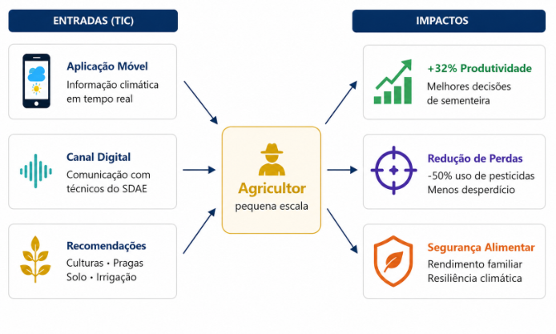

_Figura 01: Componentes principais de um Sistema de Apoio à Decisão na Agricultura._ Fonte: Turban et al. (2007). 

## **_2.2.1. Vantagens dos Sistemas de Apoio à Decisão na Agricultura_** 

Os sistemas de apoio à decisão emergiram como uma ferramenta importante na agricultura, fornecendo aos agricultores informação baseada em dados para optimizar a produção, reduzir o impacto ambiental e melhorar a produtividade global. A literatura científica recente identifica um conjunto de vantagens concretas e mensuráveis da sua adopção no sector agrícola. 

No que respeita ao aumento da produtividade, o uso de um sistema de apoio à decisão para o agendamento de irrigação numa cultura de algodão aumentou o rendimento e a produtividade hídrica em 32% e 20%, respectivamente, quando comparado ao recurso exclusivo a sensores de humidade do solo. Um sistema desenvolvido na Índia, focado na optimização do uso de fertilizantes para as culturas de milho e pimenta, permitiu aos agricultores reduzir significativamente a aplicação excessiva de fertilizantes, com um aumento médio de rendimento de aproximadamente 6%. 

Estes sistemas permitem ainda optimizar o uso de recursos, aumentar a produtividade, reduzir riscos e melhorar a rentabilidade, ao possibilitarem a simulação de vários cenários, a avaliação de resultados potenciais e a identificação das linhas de acção mais adequadas. No 

contexto de Nhamatanda, onde os recursos hídricos e os insumos agrícolas são limitados, esta capacidade de optimização assume particular relevância. 

Quanto à redução do uso de pesticidas, estudos demonstram que os sistemas de apoio à decisão podem reduzir para metade o uso de fungicidas, em comparação com estratégias baseadas em calendário fixo, sem aumentar o risco de doenças nas culturas, vantagem especialmente relevante para os agricultores de Nhamatanda, que frequentemente recorrem a aplicações preventivas de pesticidas por falta de informação técnica atempada. 

No que se refere à melhoria das decisões sobre culturas, a determinação da cultura mais adequada requer a consideração de uma combinação complexa de factores, incluindo as propriedades do solo, os padrões climáticos regionais, a disponibilidade de água, o acesso a sementes de qualidade, a procura do mercado e as políticas de apoio governamental. Nos sistemas agrícolas de pequena escala, onde uma escolha inadequada de cultura pode causar perdas económicas graves para toda uma época, os sistemas de recomendação baseados em dados fornecem um apoio valioso para uma tomada de decisão mais informada. 

Por último, os avanços no sensoriamento remoto, na aprendizagem automática e na conectividade móvel têm melhorado a resolução espacial e temporal dos resultados destes sistemas, permitindo conselhos personalizados ao nível do campo e da exploração agrícola. O design centrado no utilizador e a adaptação agro-ecológica têm igualmente contribuído para melhorar a acessibilidade e a taxa de adopção, sobretudo em contextos de recursos limitados. 

## **2.3. Tecnologias de Informação e Comunicação na Agricultura** 

As tecnologias de informação e comunicação aplicadas à agricultura englobam um conjunto diversificado de ferramentas digitais, entre as quais aplicações móveis, plataformas web, interfaces de programação de dados climáticos e sistemas de mensagens, que visam melhorar o acesso à informação e a comunicação entre os diferentes actores da cadeia agrícola. Munyanyi et al. (2017) destacam o impacto das plataformas digitais na disseminação do conhecimento agrícola, sublinhando que a comunicação digital entre técnicos e agricultores reduz as assimetrias de informação e melhora a eficiência das decisões de produção. 

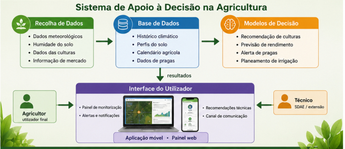

_Figura 02: Impacto das Tecnologias de Informação e Comunicação na agricultura de pequena escala._ 

Fonte:Kephe et al. (2020). 

Em Moçambique, a expansão das redes de telecomunicações nas zonas rurais tem criado condições favoráveis à adopção de soluções deste tipo no sector agrícola. O projecto CSAW Sofala, implementado na província de Sofala, utilizou ferramentas de recolha de dados geográficos digitais para melhorar a medição das condições agroclimáticas e a monitorização dos ciclos agrícolas em comunidades rurais, beneficiando cerca de 7.800 famílias de agricultores. Esta experiência demonstra a viabilidade da implementação de soluções digitais em contextos semelhantes ao de Nhamatanda. 

## **_2.3.1. Plataformas Digitais Agrícolas_** 

As plataformas digitais agrícolas constituem ambientes tecnológicos que integram múltiplas funcionalidades, como a recolha de dados, o processamento, a comunicação e a visualização, numa única interface acessível a agricultores, técnicos e gestores. Callejón et al. (2020) demonstram que a criação de plataformas interactivas que ligam agricultores e técnicos facilita a transferência de conhecimento e aumenta a capacidade de resposta a eventos climáticos extremos e a surtos de pragas. 

O desenvolvimento de plataformas híbridas, que funcionam simultaneamente em dispositivos móveis e em ambiente web, tem-se revelado particularmente adequado a contextos rurais africanos, onde o acesso à internet é intermitente e os utilizadores possuem diferentes tipos de dispositivos. Segundo a GSMA (2023), a penetração do telemóvel nas zonas rurais da África 

Subsaariana ultrapassa os 50%, representando uma oportunidade concreta para a disseminação de soluções agrícolas digitais. 

## **_2.3.2. APIs Meteorológicas e Dados Climáticos_** 

A integração de interfaces de programação de aplicações meteorológicas em sistemas de informação agrícola permite disponibilizar dados climáticos em tempo real, como temperatura, precipitação, humidade relativa e previsões, sem a necessidade de infraestrutura meteorológica própria. Serviços como a Open-Meteo API, a OpenWeatherMap e a Weather API da Meteomatics disponibilizam gratuitamente dados climáticos georreferenciados com cobertura global, incluindo as regiões rurais de Moçambique. 

Esta abordagem é particularmente relevante para o distrito de Nhamatanda, onde a escassez de estações meteorológicas automáticas limita o acesso dos agricultores a previsões climáticas locais. A integração de APIs externas no sistema proposto permite colmatar esta lacuna sem incorrer nos custos associados à instalação e à manutenção de equipamento meteorológico próprio. 

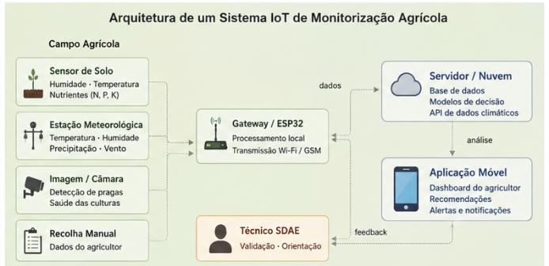

_Figura 03: Arquitectura de um sistema IoT de monitorização agrícola._ Fonte: Aziz et al. (2023); Mhlanga & Ndhlovu (2023). 

## **_2.3.3. Comunicação Digital entre Agricultores e Técnicos_** 

A comunicação digital entre agricultores e técnicos de extensão agrícola representa um dos domínios de maior impacto das tecnologias de informação e comunicação na agricultura em contextos africanos, ao facilitar a transição dos agricultores da dependência de práticas 

tradicionais para a adopção da agricultura de precisão, promovendo a sustentabilidade, o aumento da produtividade e a resiliência. 

Estudos realizados em contextos semelhantes ao de Nhamatanda indicam que os canais de comunicação digital, incluindo aplicações de mensagens, notificações push e painéis de gestão, permitem aos técnicos disseminar alertas sobre pragas, actualizações de boas práticas e recomendações de culturas de forma rápida e eficiente, superando as limitações geográficas que caracterizam as zonas rurais. 

## **2.4. Agricultura Sustentável e Gestão de Recursos** 

A agricultura sustentável é definida como um sistema de produção agrícola que satisfaz as necessidades alimentares do presente sem comprometer a capacidade das gerações futuras de satisfazerem as suas próprias necessidades, assegurando simultaneamente a viabilidade económica dos agricultores e a preservação dos recursos naturais (FAO, 2022). Hoffman (2018) sublinha que a adopção de tecnologias digitais na agricultura contribui directamente para a sustentabilidade, ao promover práticas mais eficientes no uso de recursos como a água, os fertilizantes e os pesticidas. 

Na África Subsaariana, a gestão sustentável dos recursos naturais enfrenta desafios específicos relacionados com a degradação do solo, a variabilidade climática e o acesso limitado a insumos e tecnologias. A Convenção das Nações Unidas de Luta contra a Desertificação estima que até dois terços das terras aráveis em África são afectadas pela degradação dos solos, impactando directamente cerca de 485 milhões de pessoas, o que reforça a necessidade de soluções agrícolas inovadoras e adaptadas às realidades locais. 

A monitorização da humidade do solo constitui um elemento central da gestão sustentável dos recursos hídricos na agricultura, permitindo optimizar as decisões de irrigação, reduzir o desperdício de água e determinar o momento ideal para a sementeira. No sistema proposto para Nhamatanda, esta monitorização é realizada de forma participativa, com os agricultores a fornecerem os dados e os técnicos do SDAE a validarem e a interpretarem os resultados. Os agricultores familiares têm potencial para enfrentar os complexos desafios da região, desde que lhes seja assegurado o apoio necessário, nomeadamente assistência tecnológica em agrotecnologia, infraestruturas e desenvolvimento organizacional, capaz de impulsionar as economias locais. 

## **2.5. Trabalhos Relacionados.** 

O FarmHack, plataforma móvel desenvolvida no Quénia em 2021 para agricultores do leste africano, integra previsões meteorológicas, recomendações de culturas e um canal de comunicação com técnicos agrícolas, tendo demonstrado um aumento médio de 23% na produtividade agrícola nas comunidades participantes, atribuído principalmente à melhoria das decisões sobre o momento da sementeira (Mhlanga & Ndhlovu, 2023). 

O CSAW Sofala, projecto implementado em Moçambique entre 2020 e 2024 pela NCBA CLUSA com apoio da Agência Austríaca de Desenvolvimento, utilizou ferramentas de recolha de dados geográficos digitais para melhorar a segurança alimentar e os rendimentos agrícolas de famílias de pequena escala nos distritos de Búzi, Caia e Machanga. A proximidade geográfica e temática deste projecto com o presente estudo torna-o uma referência particularmente relevante. 

O AgroSAT, sistema de apoio à decisão desenvolvido na África do Sul em 2022 para agricultores da província de Limpopo, integra dados de sensoriamento remoto, previsões climáticas e modelos de rendimento para emitir recomendações de gestão das culturas, tendo demonstrado que a combinação de dados climáticos e informação sobre o solo em tempo real reduz significativamente as perdas associadas a eventos climáticos extremos (Kephe et al., 2020). 

O M-Kilimo, plataforma tanzaniana de serviços de informação agrícola via SMS e aplicação móvel lançada em 2019, conecta agricultores com técnicos de extensão e foi adoptada por mais de 150.000 agricultores, demonstrando que mesmo soluções de baixa tecnologia, baseadas em SMS, têm impacto significativo na melhoria da tomada de decisão agrícola em contextos de conectividade limitada. 

A análise comparativa destes sistemas revela três características comuns aos projectos de maior sucesso: a adaptação da interface ao nível de literacia digital dos utilizadores, a integração de fontes de dados externas sem dependência de infraestrutura própria, e o envolvimento activo dos técnicos de extensão como intermediários de confiança entre o sistema e os agricultores. Estas características foram tidas em conta na concepção do sistema proposto para o distrito de Nhamatanda. 

## **CAPÍTULO III: METODOLOGIA** 

O presente capítulo descreve a abordagem metodológica adoptada no desenvolvimento da investigação, incluindo o tipo de pesquisa, os métodos de recolha e análise de dados, a população e amostra do estudo, os instrumentos utilizados e a metodologia de desenvolvimento do sistema proposto. 

## **3.1. Tipo de Pesquisa** 

A presente investigação classifica-se quanto à sua natureza, abordagem e objetivos da seguinte forma: 

**Quanto à natureza:** trata-se de uma pesquisa aplicada, uma vez que tem como finalidade gerar conhecimento com aplicação prática direta na resolução de um problema concreto — a ausência de um sistema de informação e apoio à tomada de decisão para os agricultores do distrito de Nhamatanda (Gil, 2002). 

**Quanto à abordagem:** adopta-se uma abordagem mista, combinando métodos quantitativos e qualitativos. A componente quantitativa está associada à recolha e análise estatística dos dados obtidos através de questionários aplicados aos agricultores. A componente qualitativa está associada à análise das entrevistas realizadas com os técnicos do SDAE, que permitiram aprofundar o conhecimento sobre os desafios e necessidades do contexto em estudo (Creswell, 2014). 

**Quanto aos objetivos:** a pesquisa é exploratória e descritiva. Exploratória porque aborda uma problemática ainda pouco estudada no contexto específico do distrito de Nhamatanda. Descritiva porque descreve as características, necessidades e comportamentos dos agricultores e técnicos em relação ao acesso à informação agrícola e ao uso de tecnologias digitais (Gil, 2002). 

## **3.2. Método de Desenvolvimento do Sistema** 

Para o desenvolvimento do sistema de informação proposto, adoptou-se a metodologia ágil Scrum, proposta por Schwaber & Sutherland (2020). O Scrum é uma framework iterativa e incremental amplamente utilizada no desenvolvimento de software, que organiza o trabalho em ciclos curtos denominados sprints, com duração geralmente entre duas a quatro semanas, permitindo uma adaptação contínua aos requisitos dos utilizadores. 

A adopção do Scrum justifica-se pela natureza evolutiva dos requisitos do sistema, que foram sendo refinados à medida que os dados recolhidos junto dos agricultores e técnicos do SDAE foram analisados. Os principais elementos do Scrum aplicados neste projecto foram: 

- ❖ **Product Backlog:** lista priorizada de funcionalidades e requisitos do sistema, definida com base nos resultados do levantamento de dados junto dos agricultores e técnicos do SDAE. 

- ❖ **Sprints:** ciclos de desenvolvimento de duas semanas, cada um com objetivos específicos — desde a modelagem da base de dados até ao desenvolvimento dos módulos de recomendação de culturas e comunicação. 

- ❖ **Sprint Review:** revisão dos incrementos desenvolvidos em cada sprint, com validação junto do orientador e dos utilizadores piloto. 

- ❖ **Retrospectiva:** análise do processo de desenvolvimento ao fim de cada sprint, identificando melhorias a introduzir no ciclo seguinte. 

## **3.3. População e Amostra** 

## **_3.3.1. População_** 

A população deste estudo é constituída por dois grupos distintos: os agricultores do distrito de Nhamatanda vinculados ao SDAE, e os técnicos de extensão agrícola que trabalham no SDAE de Nhamatanda. Estes dois grupos foram selecionados por serem os utilizadores directos do sistema proposto e por possuírem o conhecimento empírico e técnico necessário para fundamentar o levantamento de requisitos. 

## **_3.3.2. Amostra dos Agricultores_** 

Uma vez que o número total de agricultores cadastrados no SDAE de Nhamatanda não foi possível apurar com exactidão, recorreu-se à fórmula de amostragem para populações desconhecidas ou infinitas, proposta por Cochran (1977): 

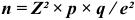

Onde: 

- ❖ **n =** tamanho da amostra 

- ❖ **Z =** valor crítico correspondente ao nível de confiança de 95% → Z = 1,96 

- ❖ **p =** proporção estimada da população com a característica de interesse → p = 0,5 

- ❖ **q =** complemento de p → q = 1 − p = 0,5 

- ❖ **e =** margem de erro admitida → e = 0,10 (10%) 

Aplicando a fórmula: 

**n = (1,96)² × 0,5 × 0,5 / (0,10)² = 3,8416 × 0,25 / 0,01 = 96 agricultores** 

O valor calculado (96 agricultores) foi arredondado para 100 participantes, de modo a facilitar a distribuição proporcional da amostra pelas diferentes zonas e aldeias do distrito, bem como a organização logística da recolha de dados. A amostra dos agricultores é, portanto, de 100 participantes, seleccionados de forma aleatória simples em diferentes zonas e aldeias do distrito de Nhamatanda, garantindo a representatividade geográfica e social da população estudada. 

## **_3.3.3. Amostra dos Técnicos do SDAE_** 

Relativamente aos técnicos de extensão agrícola do SDAE de Nhamatanda, dado o número reduzido de profissionais disponíveis, optou-se pela amostragem por censo, também designada amostragem total, que consiste em incluir na amostra todos os elementos da população (Gil, 2002). Todos os técnicos de extensão agrícola em exercício de funções no SDAE de Nhamatanda foram convidados a participar no estudo através da entrevista semiestruturada. 

Tabela 01: Resumo da população e amostra do estudo. 

|**Grupo**|**Técnica Usada**|**Tipo de** **Amostragem**|**Instrumento**|**Quantidade**|
|---|---|---|---|---|
|Agricultores|Questionário|Aleatória simples|Questionário fechado (15 perguntas)|100 participantes|
|Técnicos do SDAE|Entrevista|Por censo(total)|Guião misto(15 perguntas)|Todos os técnicos disponíveis|

Fonte _: Autor (2026)._ 

## **3.4. Técnicas de Recolha de Dados** 

Para a recolha de dados primários, adoptaram-se duas técnicas complementares, em consonância com a abordagem mista da investigação: 

## **_3.4.1. Questionário_** 

O questionário foi aplicado aos 96 agricultores seleccionados na amostra, de forma presencial nas aldeias e zonas do distrito de Nhamatanda. Esta técnica foi escolhida por permitir recolher dados de um número elevado de participantes de forma rápida e padronizada, facilitando a análise estatística posterior. O questionário é composto por 15 perguntas fechadas, organizadas em quatro secções: Perfil do Inquirido, Acesso à Informação e Comunicação, Uso de Tecnologia, e Necessidades e Expectativas (vide Anexo I). 

A aplicação do questionário foi realizada pelo investigador e por um colaborador, com tradução oral para a língua local quando necessário, de modo a garantir a correcta compreensão das perguntas por parte de agricultores com baixo nível de escolaridade. 

## **_3.4.2. Entrevista Semiestruturada_** 

A entrevista semiestruturada foi aplicada a todos os técnicos de extensão agrícola do SDAE de Nhamatanda. Esta técnica foi seleccionada por permitir a recolha de informação qualitativa aprofundada, possibilitando ao entrevistador explorar as respostas dos participantes e obter dados sobre experiências, percepções e conhecimentos que não seriam captados por um questionário fechado (Yin, 2018). 

O guião de entrevista é composto por 15 perguntas de carácter misto — perguntas fechadas com opções de resposta e perguntas abertas para aprofundamento — organizadas em quatro blocos: Perfil do Entrevistado, Comunicação e Acompanhamento dos Agricultores, Informação Técnica e Gestão Agrícola, e Uso de Tecnologia e Receptividade ao Sistema (vide Anexo II). As entrevistas foram realizadas presencialmente nas instalações do SDAE de Nhamatanda, com registo escrito das respostas e assinatura de autorização pelo entrevistado. 

## **3.5. Instrumento de Recolha de Dados** 

Os instrumentos de recolha de dados foram elaborados pelo investigador com base nos objectivos específicos da investigação e nos conceitos teóricos revistos no Capítulo II. Antes da aplicação definitiva, ambos os instrumentos foram sujeitos a uma validação prévia junto do orientador do trabalho, tendo sido efectuados os ajustamentos necessários em termos de clareza, pertinência e adequação ao contexto dos participantes. 

Os instrumentos finais encontram-se disponíveis nos Anexos I e II do presente trabalho, juntamente com exemplares dos questionários preenchidos pelos participantes e as declarações de autorização assinadas pelos entrevistados, que constituem prova da realização efectiva da recolha de dados. 

## **3.6. Técnicas de Análise de Dados** 

## **_3.6.1. Análise Quantitativa_** 

Os dados recolhidos através dos questionários foram tratados com recurso a técnicas de estatística descritiva, nomeadamente cálculo de frequências absolutas e relativas (percentagens), representadas sob a forma de tabelas e gráficos de barras e sectores. Esta abordagem permitiu identificar os padrões predominantes nas respostas dos agricultores, quantificar as necessidades informacionais e avaliar o nível de receptividade ao sistema proposto. 

## **_3.6.2. Análise Qualitativa_** 

Os dados recolhidos através das entrevistas foram analisados com recurso à técnica de análise de conteúdo (Bardin, 2011), que consiste na categorização e interpretação sistemática das respostas abertas dos entrevistados. As respostas foram agrupadas em categorias temáticas correspondentes aos blocos do guião de entrevista, permitindo identificar padrões, convergências e divergências nas percepções dos técnicos do SDAE sobre os desafios da comunicação com os agricultores e a viabilidade do sistema proposto. 

## **3.7. Tecnologias e Ferramentas Utilizadas** 

## **_3.7.1. Tecnologias de Desenvolvimento_** 

**Next.js** — framework React utilizado para o desenvolvimento da interface web do sistema, com suporte a renderização do lado do servidor e geração de páginas estáticas. 

**Tailwind CSS** — framework de estilização utilizado para o design responsivo e moderno da interface, adaptável a diferentes tamanhos de ecrã. 

**Supabase** — plataforma de backend como serviço utilizada para autenticação de utilizadores, API REST e comunicação em tempo real, sem necessidade de infraestrutura própria. 

**Supabase (PostgreSQL)** — sistema de gestão de base de dados relacional utilizado para armazenar e gerir os dados do sistema, com suporte a transacções e integridade referencial. 

## **_3.7.2. Ferramentas_** 

**Visual Studio Code** — editor de código principal utilizado no desenvolvimento do sistema. 

**npm** — gestor de pacotes utilizado para instalar e gerir as dependências do projecto. 

**LucidChart** — plataforma online utilizada para a modelagem e criação dos diagramas UML do sistema. 

## **CAPÍTULO IV: APRESENTAÇÃO E DISCUSSÃO DE RESULTADOS** 

Neste capítulo são apresentados os resultados obtidos através dos métodos de recolha de dados aplicados, cuja análise serviu de base para a definição do sistema proposto. Em seguida, apresenta-se a modelagem do sistema através de diagramas UML, bem como os requisitos funcionais e não funcionais identificados. Posteriormente, é apresentada a arquitetura e as tecnologias utilizadas no desenvolvimento da solução, seguido do funcionamento da aplicação desenvolvida, através da demonstração das suas telas e funcionalidades. 

## **4.1.Interpretação dos dados coletados** 

Nesta secção são apresentados e analisados os dados obtidos através do questionário _online_ aplicado aos agricultores do distrito de Nhamatanda vinculados ao SDAE. O questionário teve como objectivo recolher informações relacionadas à percepção dos agricultores sobre o acesso à informação agrícola, os principais constrangimentos enfrentados na tomada de decisão e a receptividade à adopção de soluções tecnológicas de apoio à produção. 

O processo de recolha de dados contou com a participação de 100 agricultores seleccionados aleatoriamente em diferentes zonas do distrito, permitindo obter uma visão abrangente da realidade local. Os dados recolhidos foram organizados e apresentados em gráficos e tabelas, de modo a facilitar a visualização, interpretação e análise dos resultados obtidos. 

A análise destas informações permitiu identificar os principais constrangimentos relacionados ao acesso à informação meteorológica, à gestão do solo e à comunicação com os técnicos do SDAE, servindo igualmente como base para o levantamento dos requisitos e desenvolvimento do sistema de informação e apoio à tomada de decisão proposto nesta investigação. 

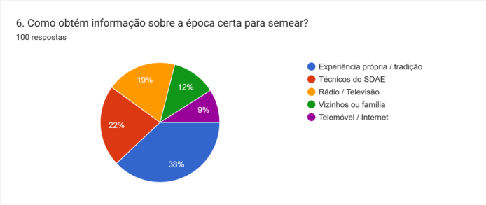

_Figura 04: Resultado Questão 6_ Fonte: Autor (2026). 

Conforme ilustrado na Figura 04, a maioria dos agricultores (38%) obtêm informação sobre a época por meio da experiência própria, seguida por 22% que obtém dos técnicos do SDAE. Temos 19% que buscam por meio da rádio e televisão, 12% dos vizinhos e 9% do telefone ou internet. Estes resultados demonstram que a maior parte dos respondentes possui um conhecimento considerável sobre a realidade  do distrito e os desafios relacionados ao acesso à informação. 

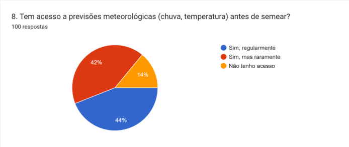

_Figura 05: Resultado Questão 8_ 

Fonte: Autor (2026). 

Conforme ilustrado na Figura 05, 44% afirma ter regularmente informação acerca das previsões meteorológicas antes de semear, 42% afirma ter mas raramente e 14% afirma nunca possuir acesso a essas informações. 

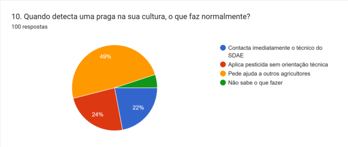

_Figura 06: Resultado Questão 10_ 

Fonte: Autor (2026). 

Conforme ilustrado na Figura 06, 49% dos agricultores pedem ajuda a outros agricultores quando detectam uma praga na sua cultura,  24% aplica pesticida sem orientação técnica, 22% 

afirma contactar imediatamente o tecnico do SDAE e os demais nao sabem o que fazer. 

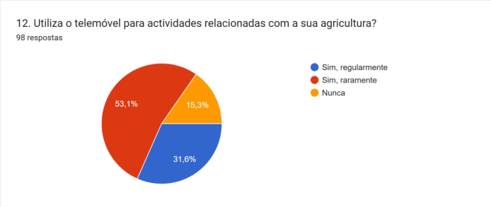

_Figura 07: Resultado Questão 12_ 

Fonte: Autor (2026). 

Conforme ilustrado na Figura 07, 53,1% afirma usar regularmente o telemóvel para actividades relacionadas com a agricultura, 31,6% afirma usar mas raramente e 15,3% afirma nunca ter usado. 

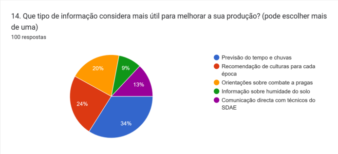

_Figura 08: Resultado Questão 14_ 

Fonte: Autor (2026). 

Conforme ilustrado na Figura 08, 34% considera que a previsão de tempo e chuvas são informações úteis para a melhoria da sua produção, 24% considera a recomendação de culturas para cada época, 20% observa acerca de orientações sobre o combate à praga como informação útil, 9% considera informação sobre humidade do solo relevante e 13% eh a favor da comunicação directa com técnicos do SDAE. 

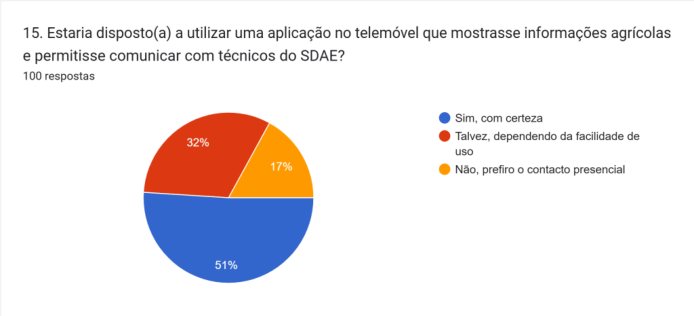

_Figura 09: Resultado Questão 15_ 

Fonte: Autor (2026). 

Conforme ilustrado na Figura 09, 51% dos agricultores estão dispostos a utilizar uma aplicação móvel que mostrasse informações agrícolas e permitisse comunicar com técnicos do SDAE, 32% dos agricultores estão sim dispostos, mas dependendo da facilidade de uso e 17% preferem o contacto presencial. 

## **4.2. Modelagem do sistema** 

## **4.2.1. Requisitos** 

Segundo (Sommerville, 2011) os requisitos de um sistema são as descrições do que o sistema deve fazer, os serviços que oferece e as restrições a seu funcionamento. 

## **Requisitos funcionais** 

Requisitos funcionais são declarações de serviços que o sistema deve fornecer, de como o sistema deve reagir a entradas específicas e de como o sistema deve se comportar em determinadas situações. Em alguns casos, os requisitos funcionais também podem explicitar o que o sistema não deve fazer (Sommerville, 2011). 

Tabela 02: Requisitos Funcionais 

|**Código**|**Descrição**|
|---|---|
|**RF01**|O sistema deve permitir o registo e autenticação de utilizadores com três perfis (Administrador, Técnico SDAE e Agricultor), gerando um token JWT e redireccionando cada utilizador para o dashboard correspondente ao seu perfil.|
|**RF02**|O sistema deve permitir ao agricultor registar, editar e consultar as suas parcelas agrícolas (nome, área, tipo de solo, localização geográfica), e ao técnico SDAE consultar as parcelas dos agricultores que acompanha.|
|**RF03**|O sistema deve permitir ao agricultor registar leituras de humidade do solo, incluindo valor percentual, observações, data e hora, associadas a uma parcela.|
|**RF04**|O sistema deve validar automaticamente se o valor de humidade registado está dentro dos parâmetros normais, assinalar anomalias e notificar o técnico SDAE responsável.|
|**RF05**|O sistema deve permitir ao técnico SDAE validar as leituras de solo registadas pelos agricultores.|
|**RF06**|O sistema deve disponibilizar um catálogo de culturas com informações sobre época ideal, temperatura, humidade mínima e duração do ciclo.|
|**RF07**|O sistema deve permitir ao técnico SDAE emitir recomendações de culturas para parcelas específicas, com descrição personalizada.|
|**RF08**|O sistema deve notificar o agricultor sempre que receber uma nova recomendação e permitir a sua consulta, ordenada por data, no painel.|
|**RF09**|O sistema deve disponibilizar um catálogo de pragas, com filtro por cultura, contendo informações sobre culturas afectadas, época de surgimento e método de controlo.|
|**RF10**|O sistema deve permitir ao agricultor reportar a ocorrência de uma praga associada a uma parcela, com descrição e data.|
|**RF11**|O sistema deve notificar o técnico SDAE sempre que uma nova ocorrência de praga for reportada e permitir o acompanhamento da sua resolução.|
|**RF12**|O sistema deve permitir a comunicação directa (chat interno) entre agricultor e técnico SDAE, com histórico de mensagens.|
|**RF13**|O sistema deve gerar alertas automáticos para eventos relevantes (novas leituras, recomendações, ocorrências de pragas e mensagens) e permitir marcá-los como lidos.|
|**RF14**|O sistema deve permitir ao administrador gerir (cadastrar e editar) os catálogos de culturas e de pragas.|

Fonte: Autor(2026). 

## **Requisitos não funcionais** 

Os requisitos não funcionais são requisitos que não estão diretamente relacionados com os serviços específicos oferecidos pelo sistema a seus usuários, podendo estar relacionados às propriedades emergentes do sistema. 

Tabela 03: Requisitos não funcionais 

|**Código**|**Descrição**|**Categoria**|
|---|---|---|
|**RNF01**|As senhas dos utilizadores devem ser armazenadas com hash (bcrypt), o acesso a cada funcionalidade deve respeitar o perfil do utilizador, e o token JWT de autenticação deve expirar em 24 horas.|Segurança|
|**RNF02**|A aplicação móvel deve ser desenvolvida em Flutter, garantindo compatibilidade com dispositivos Android e iOS.|Portabilidade|
|**RNF03**|A API REST deve ser desenvolvida em Node.js com Express, e a base de dados relacional implementada em MySQL, com relações conforme o Diagrama ER.|Arquitectura|
|**RNF04**|As actualizações de mensagens e alertas devem ocorrer por polling, com verificação a cada 30 segundos, sem necessidade de WebSockets no MVP.|Desempenho|
|**RNF05**|Operações críticas na base de dados devem usar transacções SQL para garantir integridade, e o código-fonte deve ser gerido com controlo de versões (Git/GitHub).|Confiabilidade|

Fonte: Autor(2026). 

## **4.3. Diagramas** 

## **4.3.1. Diagrama entidade relacionamento** 

Segundo (Sommerville, 2011) o diagrama entidade relacionamento é um modelo conceitual de um banco de dados com foco na construção de uma representação de alta qualidade dos fenômenos selecionados de domínio. 

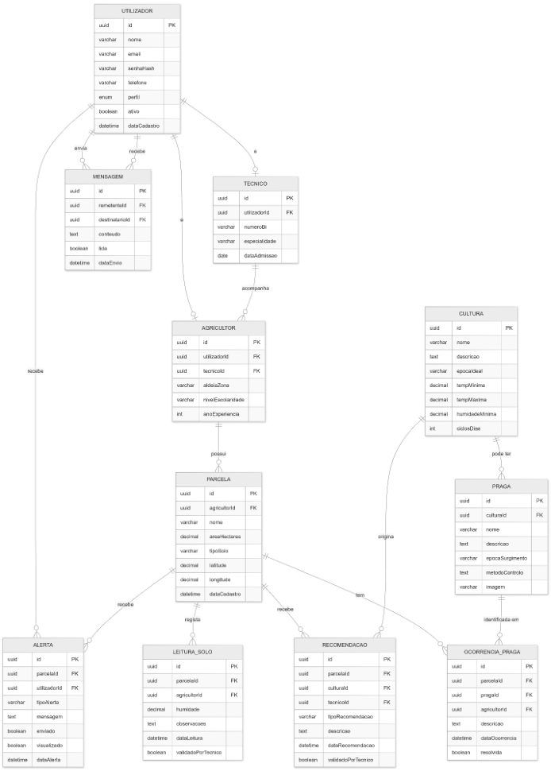

_Figura 04.Diagrama Entidade Relacionamento._ 

Fonte: Autor (2026). 

## **4.3.2.Diagrama de sequência** 

A UML define várias formas de diagrama de interação, das quais a mais comum é o diagrama de sequência. Normalmente, um diagrama de sequência captura o comportamento de um único cenário. O diagrama mostra vários exemplos de objetos e mensagens que são passadas entre esses objetos dentro de um caso de uso (Fowler, 2003). 

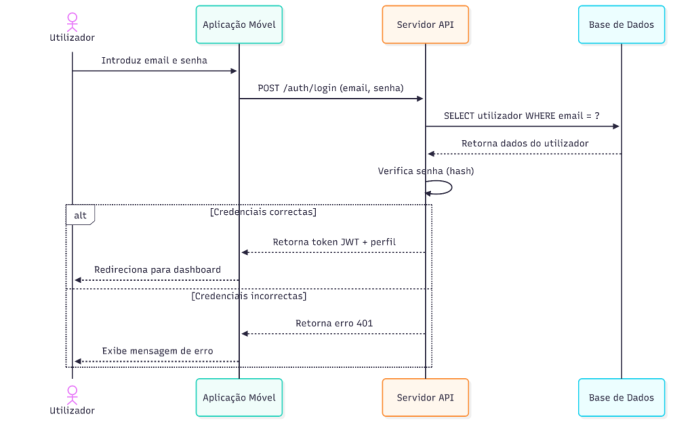

_Figura 05.Diagrama de sequência:login._ Fonte: Autor(2026). 

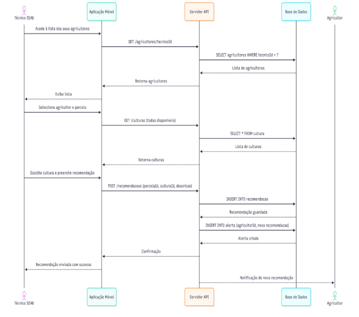

_Figura 06.Diagrama de sequência: emissão do técnico._ 

Fonte: Autor(2026). 

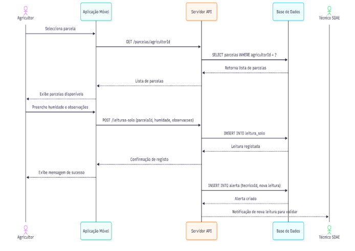

_Figura 07.Diagrama de sequência: registo do solo._ 

Fonte: Autor(2026). 

## **4.3.3.Diagrama de classes** 

Segundo (Fowler, 2003) um diagrama de classes descreve os tipos de objetos presentes no sistema e os vários tipos de relacionamentos estáticos existentes entre eles. Os diagramas de classes também mostram as propriedades e as operações de uma classe e as restrições. 

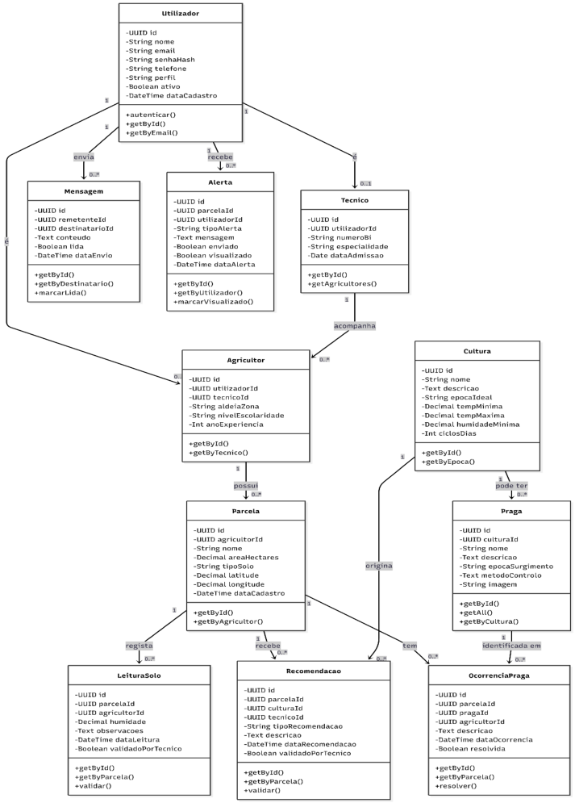

_Figura 08.Diagrama de classes._ 

Fonte: Autor(2026). 

## **4.3.4.Diagrama de Caso de Uso** 

Os casos de uso são uma técnica para captar os requisitos funcionais de um sistema. Eles servem para descrever as interações típicas entre os usuários de um sistema e o próprio sistema, fornecendo uma narrativa sobre como o sistema é utilizado (Fowler, 2003). 

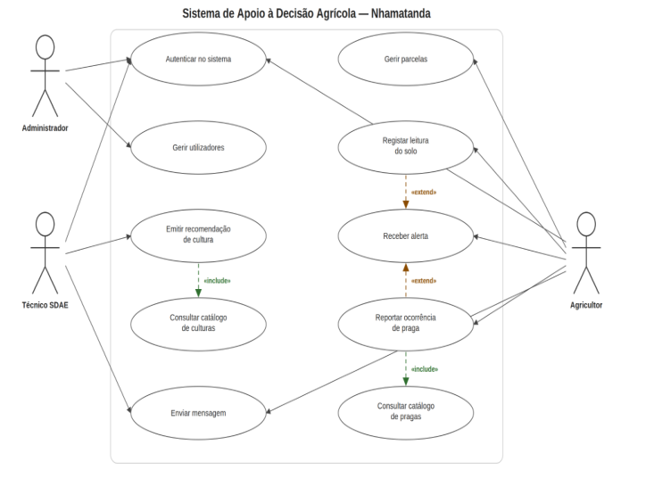

_Figura 09.Diagrama de caso de uso._ 

Fonte: Autor(2026). 

## **4.3.6.Diagrama de atividade** 

Os diagramas de atividades são uma técnica para descrever lógica de procedimento, processo de negócio e fluxo de trabalho. De várias formas, eles desempenham um papel semelhante aos fluxogramas, mas a principal diferença entre eles e a notação de fluxograma é que os diagramas suportam comportamento paralelo (Fowler, 2003). 

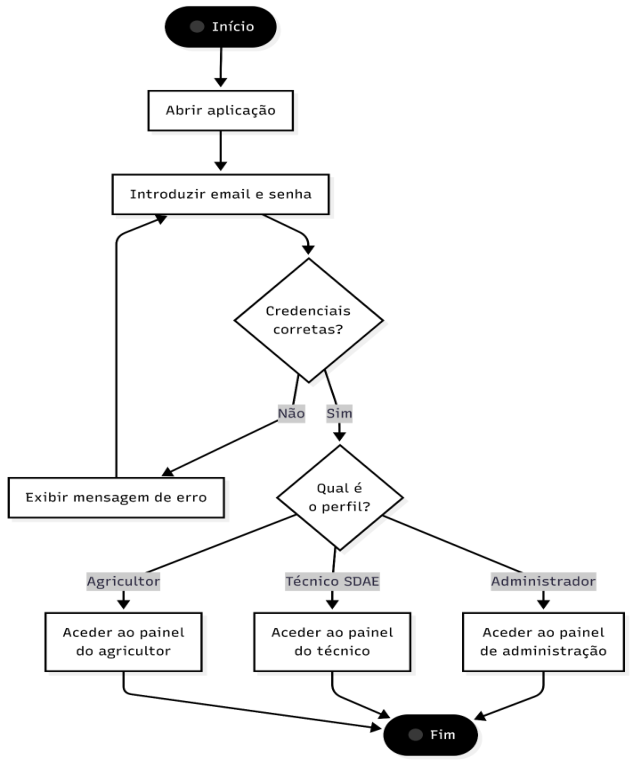

_Figura 10.Diagrama de atividade._ Fonte: Autor(2026). 

## **4.4.Arquitectura do Sistema** 

Segundo Pressman e Maxim (2016), a arquitectura de um sistema é a estrutura ou estruturas do sistema que compreende os seus elementos de software e hardware, as propriedades externamente visíveis desses elementos e as relações entre eles. No contexto do sistema de informação e apoio à tomada de decisão para agricultores do SDAE no distrito de 

Nhamatanda, a arquitectura foi concebida de forma a garantir a separação clara das responsabilidades entre as camadas de apresentação, lógica de negócio e dados, assegurando a escalabilidade e a facilidade de manutenção da solução. 

## **_4.4.1. Arquitectura de Software_** 

Segundo Pressman (2010), uma arquitectura de software define uma estrutura global de um sistema, descrevendo como os seus componentes estão organizados, como interagem e quais as propriedades que governam essa interacção. Com base neste princípio, o modelo adoptado no presente sistema é uma arquitectura cliente-servidor em três camadas (three-tier architecture). 

Neste modelo, o sistema encontra-se dividido em três partes distintas e complementares: 

- **Camada de Apresentação (Front-end):** corresponde à interface web desenvolvida em Next.js, através da qual os utilizadores — agricultores, técnicos do SDAE e administrador — interagem com o sistema. É responsável pela apresentação dos dados, pela autenticação dos utilizadores, pela visualização das recomendações de culturas, alertas de pragas, leituras do solo e pelo canal de comunicação entre agricultores e técnicos. 

- **Camada de Lógica de Negócio (Back-end):** centraliza o processamento das regras de negócio do sistema, incluindo a verificação das condições de humidade do solo, a geração de recomendações de culturas com base na época do ano e nos dados disponíveis, a emissão de alertas automáticos e a gestão do canal de comunicação entre técnicos e agricultores. Esta camada é suportada pelo Supabase, que disponibiliza uma API REST gerada automaticamente e consumida pela aplicação web. 

- **Camada de Dados:** é responsável pelo armazenamento persistente de toda a informação do sistema, incluindo os dados das parcelas, leituras do solo, recomendações emitidas, ocorrências de pragas, mensagens trocadas e registos de alertas. O armazenamento é gerido pelo Supabase (PostgreSQL), que assegura a integridade referencial e o suporte a transacções. 

A comunicação entre a camada de apresentação e a camada de lógica de negócio é realizada através de requisições HTTP/HTTPS, seguindo os princípios da arquitectura REST. A camada de dados comunica com a lógica de negócio através do cliente PostgreSQL integrado no 

Supabase, garantindo a persistência e a consistência dos dados. Esta organização em três camadas está alinhada com o padrão three-tier architecture, que separa claramente a apresentação, a lógica de negócio e os dados, facilitando a manutenção e a evolução do sistema de forma independente em cada camada. 

## **_4.4.2. Demonstração das funcionalidades do sistema._** 

A Figura abaixo apresenta a página inicial do KulimaTech, que introduz a plataforma aos visitantes, apresentando o seu propósito — o apoio à decisão agrícola para o distrito de Nhamatanda — e disponibilizando o acesso à área de autenticação através do botão "Aceder ao Sistema". Esta tela funciona como ponto de entrada institucional do sistema, contextualizando o utilizador sobre os objectivos da plataforma antes do login. 

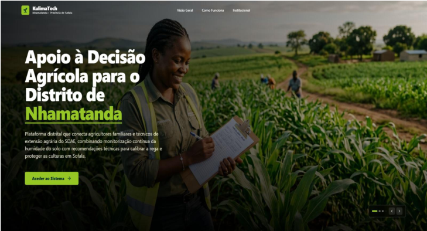

_Figura 11: Página inicial do sistema (landing page)._ Fonte: Autor (2026). 

A Figura 12 ilustra a tela de criação de conta destinada ao perfil de Agricultor, na qual o utilizador preenche os dados necessários ao seu cadastro — nome completo, e-mail, contacto, zona/comunidade de residência em Nhamatanda e palavra-passe, com respectiva confirmação e indicador de força da senha. O formulário inclui ainda a aceitação do tratamento de dados agroclimáticos, em conformidade com as boas práticas de protecção de dados dos utilizadores, sendo esta funcionalidade parte do processo de registo previsto no requisito RF01. 

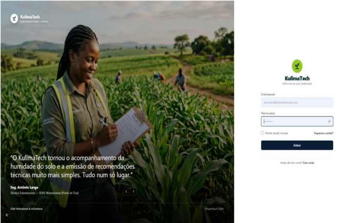

_Figura 12: Tela de registo do agricultor._ Fonte: Autor (2026). 

A Figura 13 apresenta a tela de autenticação do KulimaTech, onde o utilizador insere o seu e-mail pessoal e palavra-passe para aceder à plataforma, dispondo ainda das opções "Manter sessão iniciada" e "Esqueceu a senha?". Após a validação das credenciais, o sistema gera um token JWT e redirecciona o utilizador para o dashboard correspondente ao seu perfil (Administrador, Técnico SDAE ou Agricultor), conforme descrito no requisito RF01. 

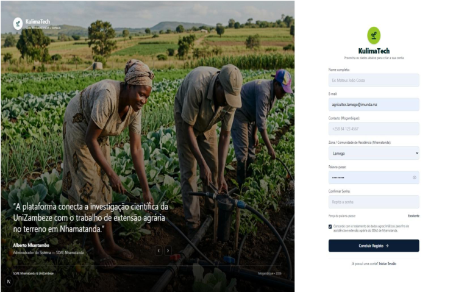

_Figura 13: Tela de autenticação (login) do sistema._ 

Fonte: Autor (2026). 

A Figura abaixo apresenta o Painel da Exploração, _dashboard_ do perfil Agricultor, que disponibiliza o gráfico de evolução da humidade do solo com base nas leituras diárias submetidas, indicando a média do período e a faixa óptima de referência, bem como o diagrama de talhões com o estado hídrico individual de cada parcela. O painel inclui ainda o diagrama do ciclo agronómico da época e informação meteorológica local, reunindo num único ecrã os dados essenciais para a tomada de decisão do agricultor, em conformidade com os requisitos RF02 e RF03. 

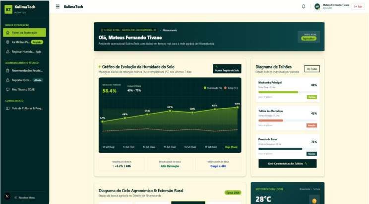

_Figura 14: Painel da Exploração do Agricultor._ 

Fonte: Autor (2026). 

A Figura abaixo ilustra o _dashboard_ do Técnico SDAE, no qual são apresentados indicadores relativos aos agricultores vinculados à sua carteira técnica, à área total das parcelas monitoradas, às leituras de humidade recentemente submetidas e às ocorrências de pragas reportadas pelos agricultores acompanhados. Este painel centraliza o acompanhamento técnico dos agricultores atribuídos, permitindo o acesso rápido às leituras pendentes de validação, em conformidade com os requisitos RF04, RF05 e RF11. 

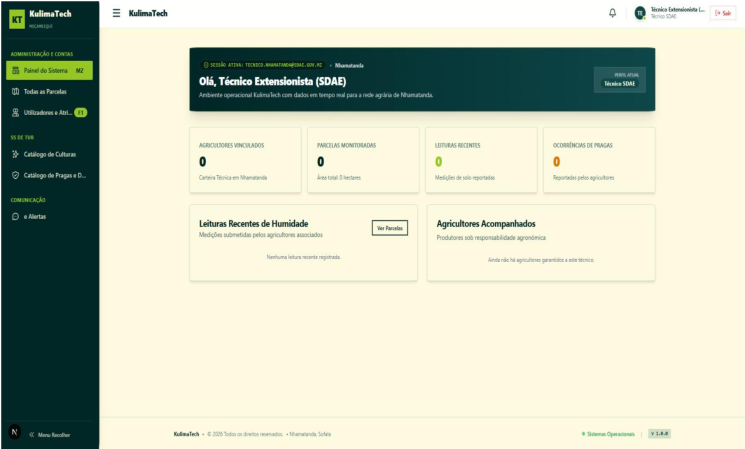

_Figura 15: Dashboard do Técnico SDAE._ 

Fonte: Autor (2026). 

A Figura abaixo apresenta o _dashboard_ do Administrador, que disponibiliza uma visão global do estado do sistema, incluindo o número de contas registadas (técnicos SDAE e agricultores), o total de parcelas monitoradas no distrito, e o número de culturas e pragas parametrizadas nos respectivos catálogos. A partir deste painel, o Administrador acede ainda aos módulos de gestão de utilizadores, ao Catálogo Mestre de Culturas e à carteira técnica dos Técnicos SDAE, em conformidade com o requisito RF14. 

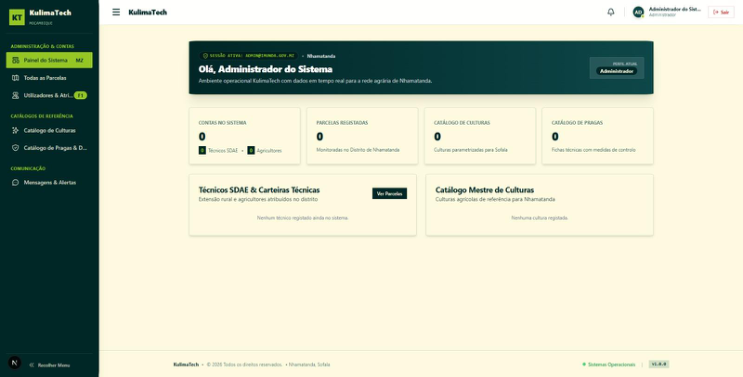

_Figura 16: Dashboard do Administrador._ 

Fonte: Autor (2026). 

## **CAPÍTULO V: CONCLUSÕES E SUGESTÕES** 

## **5.1. Conclusão** 

Este trabalho teve como propósito o desenvolvimento de um sistema de informação e apoio à tomada de decisão para os agricultores do SDAE no distrito de Nhamatanda, denominado KulimaTech, capaz de integrar dados sobre a humidade do solo, recomendações de culturas, orientações de combate a pragas e um canal de comunicação directo entre agricultores e técnicos de extensão agrícola. 

O levantamento de dados junto de 100 agricultores e da totalidade dos técnicos do SDAE confirmou os três problemas identificados na fase de problematização — acesso limitado a informação meteorológica, ausência de monitorização da humidade do solo e comunicação deficiente entre agricultores e técnicos —, e a elevada disposição dos agricultores em adoptar uma aplicação móvel validou a pertinência da solução proposta. 

Com base nestes requisitos, foi desenvolvido um protótipo funcional (MVP), numa arquitectura cliente-servidor em três camadas (Next.js, Supabase e PostgreSQL), contemplando os catorze requisitos funcionais definidos (RF01 a RF14). O sistema permite o registo e validação de leituras de humidade do solo, a emissão de recomendações de culturas, o reporte de ocorrências de pragas e a comunicação directa entre agricultor e técnico. A funcionalidade de alertas (RF13) foi implementada apenas ao nível conceptual, não tendo sido alcançada a notificação em tempo real, permanecendo como aspecto a concluir em trabalhos futuros. 

Importa referir que o trabalho resultou num protótipo de demonstração e validação de conceito, testado com um grupo restrito de utilizadores piloto, não tendo sido possível, dentro do âmbito e do tempo disponíveis, proceder à sua implementação em larga escala junto da totalidade dos agricultores e técnicos do distrito. Os resultados alcançados devem, por isso, ser interpretados como indicadores de viabilidade técnica e de aceitação inicial, e não como uma avaliação de impacto em produção real, ficando factores como a conectividade, a literacia digital e a disponibilidade de dispositivos por avaliar numa fase de implementação efectiva. 

## **5.2. Sugestões** 

- Concluir o módulo de alertas e notificações: finalizar a implementação da funcionalidade de alertas (RF13), assegurando a notificação efectiva e em tempo real dos utilizadores sobre novas leituras, recomendações, ocorrências de pragas e mensagens. 

- Implementação em maior escala: validar o sistema com um número mais alargado de agricultores e técnicos, ao longo de pelo menos um ciclo agrícola completo, para avaliar o seu impacto real. 

- Previsões meteorológicas: integrar APIs externas (ex.: Open-Meteo, OpenWeatherMap) para fornecer previsões de chuva e temperatura, permitindo decisões mais antecipadas de sementeira e rega. 

- Sensores de humidade do solo (IoT): substituir progressivamente as leituras manuais por sensores de baixo custo instalados nas parcelas, aumentando a fiabilidade dos dados em tempo real. 

- Aprendizagem automática: explorar modelos preditivos simples, com base nos dados acumulados, para sugerir janelas ideais de sementeira e antecipar riscos de pragas. 

- Suporte offline: desenvolver sincronização de dados para zonas com conectividade limitada, permitindo o registo de informação sem ligação activa à internet. 

- Expansão de âmbito: alargar o catálogo de culturas e pragas a outros distritos de Sofala ou do país, mediante validação técnica local. 

- Sustentabilidade do projecto: avaliar, em trabalhos futuros, os custos de manutenção, formação de utilizadores e possíveis parcerias institucionais para garantir a continuidade do sistema. 

## **CAPÍTULO VI: REFERÊNCIA BIBLIOGRÁFICA** 

AL-FUQAHA, A. et al. Internet of Things: A Survey on Enabling Technologies, Protocols, and Applications. _IEEE Communications Surveys & Tutorials_ , v. 17, n. 4, p. 2347–2376, 2015. 

BARDIN, L. _Análise de Conteúdo_ . São Paulo: Edições 70, 2011. 

CALLEJÓN, A. et al. Plataformas interactivas para agricultores e técnicos: uma abordagem participativa. _Revista de Tecnologia Agrícola_ , v. 12, n. 3, p. 45–60, 2020. 

COCHRAN, W. G. _Sampling Techniques_ . 3. ed. Nova Iorque: John Wiley & Sons, 1977. 

CRESWELL, J. W. _Research Design: Qualitative, Quantitative, and Mixed Methods Approaches_ . 4. ed. Thousand Oaks: SAGE Publications, 2014. 

FAO — FOOD AND AGRICULTURE ORGANIZATION. _The State of Food and Agriculture 2022_ . Roma: FAO, 2022. Disponível em: https://www.fao.org/publications. Acesso em: mar. 2026. 

GIL, A. C. _Métodos e Técnicas de Pesquisa Social_ . 6. ed. São Paulo: Atlas, 2002. 

GODWIN, R. J. et al. _Precision Agriculture: A Challenge for Crop Nutrition Management_ . Plant and Soil, v. 247, p. 143–149, 2003. 

GSMA. _The State of Mobile Internet Connectivity Report 2023_ . Londres: GSMA, 2023. Disponível em: https://www.gsma.com. Acesso em: mar. 2026. 

HOFFMAN, V. Digital technologies and sustainable agriculture. _Journal of Agricultural Sciences_ , v. 9, n. 2, p. 112–128, 2018. 

KEPHE, P. N. et al. Decision support systems for smallholder farmers in southern Africa. _Agricultural Systems_ , v. 185, 2020. 

MHLANGA, D.; NDHLOVU, E. Digital agriculture and smallholder farmer productivity in Sub-Saharan Africa. _Technology in Society_ , v. 73, 2023. 

MINISTÉRIO DA AGRICULTURA E SEGURANÇA ALIMENTAR DE MOÇAMBIQUE. _Relatório Anual do Sector Agrícola 2019_ . Maputo: MASA, 2019. 

MUNYANYI, W. et al. Digital communication platforms and agricultural knowledge dissemination in Africa. _African Journal of Agricultural Research_ , v. 12, n. 18, p. 1520–1530, 2017. 

OASIS. _MQTT Version 5.0 — OASIS Standard_ . OASIS Open, 2019. Disponível em: https://docs.oasis-open.org/mqtt. Acesso em: abr. 2026. 

O'BRIEN, J. A.; MARAKAS, G. M. _Management Information Systems_ . 10. ed. Nova Iorque: McGraw-Hill, 2011. 

PATIL, S. et al. LoRaWAN-based water quality monitoring system for lakes and rivers. _International Journal of Advanced Research in Engineering and Technology_ , v. 11, n. 4, p. 180–190, 2020. 

SCHWABER, K.; SUTHERLAND, J. _The Scrum Guide: The Definitive Guide to Scrum — The Rules of the Game_ . Scrum.org, 2020. Disponível em: https://scrumguides.org. Acesso em: mar. 2026. 

SPRAGUE, R. H.; CARLSON, E. D. _Building Effective Decision Support Systems_ . Englewood Cliffs: Prentice-Hall, 1982. 

TURBAN, E. et al. _Decision Support and Business Intelligence Systems_ . 8. ed. Upper Saddle River: Pearson Prentice Hall, 2007. 

YIN, R. K. _Case Study Research and Applications: Design and Methods_ . 6. ed. Thousand Oaks: SAGE Publications, 2018. 

**APÊNDICES** 

**APÊNDICE I: Questionário sobre o Acesso à Informação Agrícola e o Uso de Tecnologias Digitais pelos Agricultores do Distrito de Nhamatanda.** 

|Prezado(a),|
|---|
|Encontro-me a frequentar o curso de Engenharia Informática na Universidade Zambeze.|
|Estou a realizar um Trabalho de Conclusão de Curso (TCC) sobre o tema “Desenvolvimento de um sistema de Informação e Apoio À tomada de Decisão para Agricultores do SDAE no distrito de Nhamatanda”|
|Os dados recolhidos neste questionário serão utilizados exclusivamente para fins académicos e científicos, contribuindo para o desenvolvimento da pesquisa em curso.|
|Leia atentamente cada questão. Por favor, utilize as linhas disponibilizadas para responder às perguntas abertas e assinale com um ‘X’ as questões de múltipla escolha.|
|Agradeço imensamente a sua colaboração no preenchimento deste questionário, pois a análise das respostas será de grande valia para a pesquisa em curso.|
|**Muito obrigado**|
|______________________________ **(Marcelo Tesai Faife)**|

# **BLOCO A — PERFIL DO ENTREVISTADO** 

**1.** Qual é a sua função no SDAE de Nhamatanda? Resposta:

___________________________________________________________________________ 

**2.** Há quantos anos trabalha como técnico de extensão agrícola? 

   - ☐  Menos de 2 anos 

   - ☐  2 – 5 anos 

   - ☐  6 – 10 anos 

   - ☐  Mais de 10 anos 

**3.** Quantos agricultores acompanha regularmente no distrito (aproximadamente)? 

   - ☐  Menos de 20 

   - ☐  20 – 50 

   - ☐  51 – 100 

   - ☐  Mais de 100 

# **BLOCO B — COMUNICAÇÃO E ACOMPANHAMENTO DOS AGRICULTORES** 

**4.** Consegue visitar os agricultores nas suas parcelas com a frequência necessária? 

   - ☐  Sim, consigo visitar com regularidade suficiente 

   - ☐  Não, as visitas são menos frequentes do que o necessário 

**5.** Quando um agricultor precisa de orientação urgente (ex.: surgimento de praga), como consegue contactá-lo atualmente? 

   - ☐  Por chamada telefónica 

   - ☐  Apenas em visita presencial 

   - ☐  Por mensagem de texto (SMS) 

   - ☐  Não existe mecanismo de contacto directo 

**6.** Já houve situações em que agricultores sofreram perdas por não receberem orientação técnica a tempo? 

   - ☐  Sim, acontece com frequência 

   - ☐  Sim, mas raramente 

   - ☐  Não, conseguimos sempre chegar a tempo 

# **BLOCO C — INFORMAÇÃO TÉCNICA E GESTÃO AGRÍCOLA** 

**7.** Os agricultores do distrito têm acesso a informações meteorológicas confiáveis antes da sementeira? 

   - ☐  Sim, têm bom acesso 

   - ☐  Têm acesso limitado 

   - ☐  Não têm acesso 

**8.** Existe algum método ou orientação padronizada do SDAE para avaliação da humidade do solo? 

   - ☐  Sim, existe e é aplicado regularmente 

   - ☐  Existe mas raramente é aplicado 

   - ☐  Não existe nenhum método padronizado 

**9.** Quais são as pragas mais frequentes no distrito de Nhamatanda e em que época surgem? 

Resposta:

___________________________________________________________________________ 

**10.** A informação sobre as culturas recomendadas para cada época chega facilmente aos agricultores? 

- ☐  Sim, a informação chega de forma eficiente 

- ☐  Chega, mas com atrasos 

- ☐  Raramente chega aos agricultores 

# **BLOCO D — USO DE TECNOLOGIA E RECEPTIVIDADE AO SISTEMA** 

**11.** O SDAE utiliza atualmente alguma ferramenta digital para apoiar o trabalho técnico? 

- ☐  Sim 

- ☐  Não 

11.1. Se sim, qual eh? 

___________________________________________________________________________ 

___________________________________________________________________________ 

**12.** Já teve experiência com alguma aplicação ou plataforma digital de apoio à agricultura? 

   - ☐  Sim, com experiência positiva 

   - ☐  Sim, mas a experiência não foi satisfatória 

   - ☐  Não, nunca utilizei 

**13.** Um sistema digital que integrasse dados meteorológicos, humidade do solo, recomendação de culturas e comunicação com agricultores seria útil para o distrito? 

- ☐  Sim, seria muito útil 

- ☐  Seria útil mas com limitações 

- ☐  Não seria útil neste contexto 

Justifique: 

___________________________________________________________________________ 

___________________________________________________________________________ 

**14.** Que funcionalidades considera essenciais para que o sistema seja adotado pelos agricultores locais? 

Resposta:

___________________________________________________________________________ ___________________________________________________________________________ ___________________________________________________________________________ 

___________________________________________________________________________ 

**15.** Teria disponibilidade para colaborar na validação e no teste do sistema proposto? 

- ☐  Sim, com toda a disponibilidade 

   - ☐  Sim, com disponibilidade limitada 

   - ☐  Não teria disponibilidade 

**Muito obrigado pela sua colaboração e disponibilidade!**

Data da entrevista: _____ / _____ / 2026  
Duração aproximada: ____________    Local: ____________________________  
Nome do Entrevistado: ______________________________________________ 

**APÊNDICE II: Questionário online aplicado aos agricultores do distrito de Nhamatanda.** 

# **SECÇÃO A — PERFIL DO INQUIRIDO** 

**1.** Sexo: 

   - ☐  Masculino 

   - ☐  Feminino 

**2.** Faixa etária: 

   - ☐  18 – 25 anos 

   - ☐  26 – 35 anos 

   - ☐  36 – 50 anos 

   - ☐  Mais de 50 anos 

**3.** Nível de escolaridade: 

   - ☐  Sem escolaridade 

   - ☐  Ensino Primário 

   - ☐  Ensino Secundário 

   - ☐  Ensino Superior 

**4.** Há quantos anos pratica agricultura? 

   - ☐  Menos de 5 anos 

   - ☐  5 – 10 anos 

   - ☐  11 – 20 anos 

   - ☐  Mais de 20 anos 

**5.** Qual é a principal cultura que produz? 

   - ☐  Milho 

   - ☐  Feijão 

   - ☐  Mandioca 

   - ☐  Amendoim 

   - ☐  Outra: ____________________________ 

# **SECÇÃO B — ACESSO À INFORMAÇÃO E COMUNICAÇÃO** 

**6.** Como obtém informação sobre a época certa para semear? 

   - ☐  Experiência própria / tradição 

   - ☐  Técnicos do SDAE 

   - ☐  Rádio / Televisão 

   - ☐  Vizinhos ou família 

   - ☐  Telemóvel / Internet 

**7.** Com que frequência recebe visitas ou orientações dos técnicos do SDAE? 

   - ☐  Semanalmente 

   - ☐  Mensalmente 

   - ☐  Raramente (menos de 4 vezes por ano) 

   - ☐  Nunca 

**8.** Tem acesso a previsões meteorológicas (chuva, temperatura) antes de semear? 

   - ☐  Sim, regularmente 

   - ☐  Sim, mas raramente 

   - ☐  Não tenho acesso 

**9.** Já sofreu perdas agrícolas por falta de informação sobre o tempo ou as chuvas? 

   - ☐  Sim, muitas vezes 

   - ☐  Sim, algumas vezes 

   - ☐  Nunca 

**10.** Quando detecta uma praga na sua cultura, o que faz normalmente? 

   - ☐  Contacta imediatamente o técnico do SDAE 

   - ☐  Aplica pesticida sem orientação técnica 

   - ☐  Pede ajuda a outros agricultores 

   - ☐  Não sabe o que fazer 

# **SECÇÃO C — USO DE TECNOLOGIA** 

**11.** Possui telemóvel? 

   - ☐  Sim, smartphone (com acesso à internet) 

   - ☐  Sim, telemóvel simples (sem internet) 

   - ☐  Não possuo telemóvel 

**12.** Utiliza o telemóvel para atividades relacionadas com a sua agricultura? 

   - ☐  Sim, regularmente 

   - ☐  Sim, raramente 

   - ☐  Nunca 

**13.** Já utilizou alguma aplicação móvel relacionada com agricultura ou previsão do tempo? 

   - ☐  Sim 

   - ☐  Não 

   - ☐  Não sei o que é uma aplicação móvel 

# **SECÇÃO D — NECESSIDADES E EXPECTATIVAS** 

**14.** Que tipo de informação considera mais útil para melhorar a sua produção? (pode escolher mais de uma) 

- ☐  Previsão do tempo e chuvas 

- ☐  Recomendação de culturas para cada época 

- ☐  Orientações sobre combate a pragas 

- ☐  Informação sobre humidade do solo 

- ☐  Comunicação directa com técnicos do SDAE 

**15.** Estaria disposto(a) a utilizar uma aplicação no telemóvel que mostrasse informações agrícolas e permitisse comunicar com técnicos do SDAE? 

- ☐  Sim, com certeza 

- ☐  Talvez, dependendo da facilidade de uso 

- ☐  Não, prefiro o contacto presencial 

**ANEXOS** 

**ANEXO I: Credencial de autorização para recolha de dados nos Serviços Distritais de Actividades Económicas  (SDAE).** 

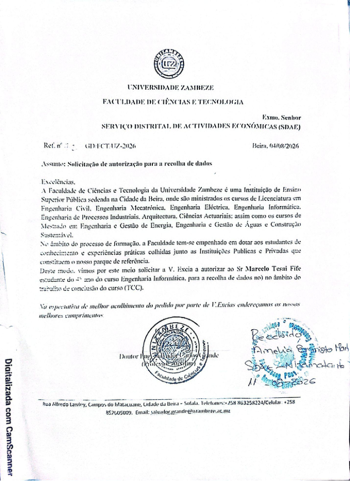

**ANEXO II: Questionário aplicado ao Serviço Distrital de Actividades Económicas(SDAE).** 

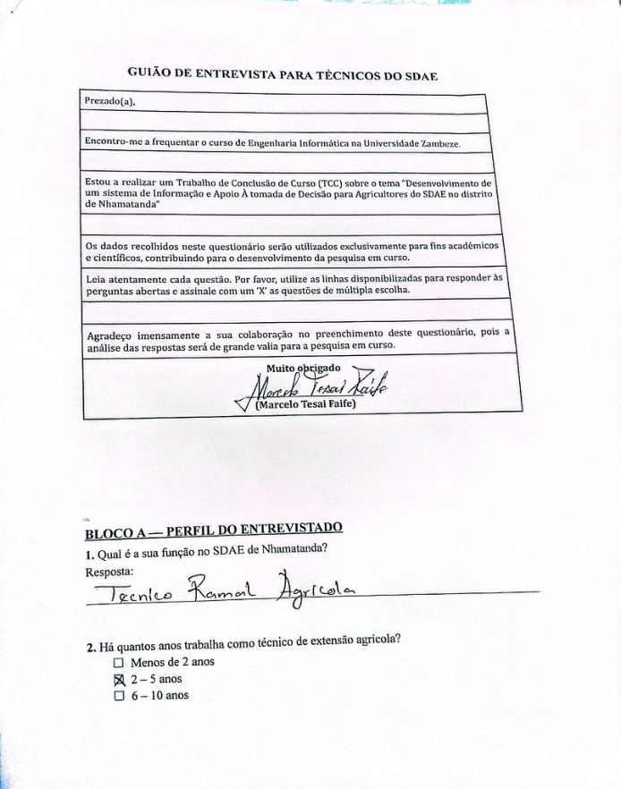

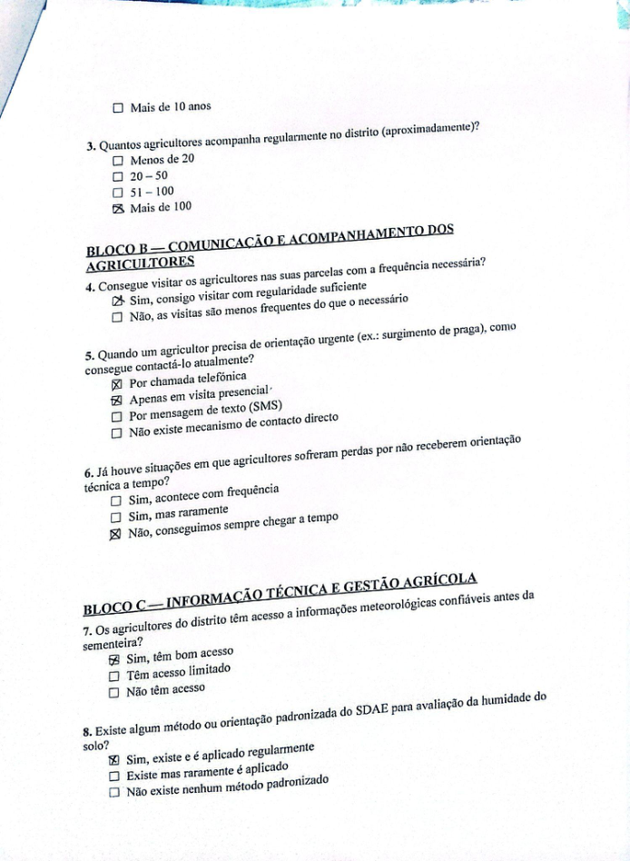

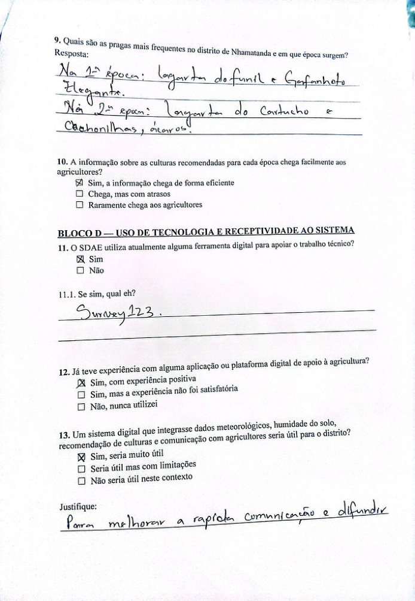

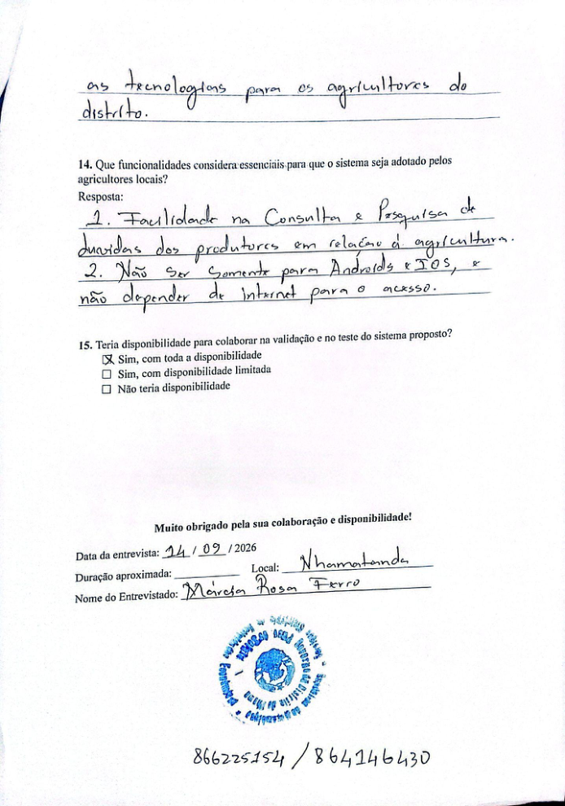
